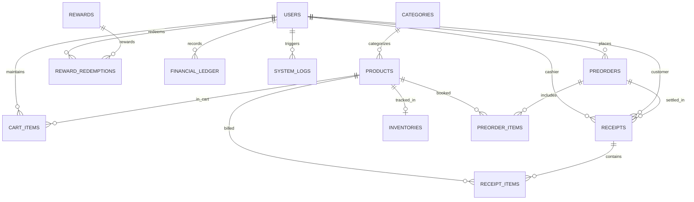

# ข้อกำหนดและโครงสร้างฐานข้อมูล (Database Schema Specification)
## ระบบร้านฟิกเกอร์และโมเดล FriendHouse (CSI402)
### โครงสร้างฐานข้อมูลเชิงสัมพันธ์ฉบับกระชับ 14 ตาราง (Streamlined Relational Schema)

เอกสารฉบับนี้จัดทำขึ้นเพื่อระบุโครงสร้างฐานข้อมูลเชิงสัมพันธ์ (Relational Database Schema) สำหรับระบบ **FriendHouse** โดยออกแบบให้กระชับ ปราศจากความซ้ำซ้อน และสอดคล้องกับพฤติกรรมการใช้งานจริงของระบบหน้าร้านและเคาน์เตอร์ส่งมอบ ประกอบด้วย **14 ตารางหลัก** ดังนี้:

---

## 1. ไดอะแกรมความสัมพันธ์ของข้อมูล (Entity-Relationship Diagram)

---

## 2. รายละเอียดตารางข้อมูล (Table Specifications)

### 2.1 กลุ่มบัญชีผู้ใช้และสิทธิ์ (Identity, Access & Points)

#### ตาราง: `Users` (บัญชีผู้ใช้งานระบบ)
เก็บบัญชีผู้ใช้งานระบบทุกกลุ่ม กำหนดบทบาทชัดเจน 1 คนต่อ 1 หน้าที่ (Role) และเก็บแต้มสะสมของสมาชิกในตัว
| คอลัมน์ | ชนิดข้อมูล | Constraints | ค่าเริ่มต้น | คำอธิบาย |
| :--- | :--- | :--- | :--- | :--- |
| `UserId` | INT | PK, IDENTITY(1,1) | - | รหัสผู้ใช้งาน |
| `UserCode` | VARCHAR(30) | UNIQUE, NOT NULL | - | รหัสประจำตัว (เช่น `USR-CUST-0081`, `USR-STAF-0012`) |
| `Email` | VARCHAR(150) | UNIQUE, NOT NULL | - | อีเมลเข้าสู่ระบบ (ใช้เป็น Username) |
| `PasswordHash` | VARCHAR(255) | NOT NULL | - | รหัสผ่านที่เข้ารหัสแล้ว (BCrypt Work Factor 12) |
| `Phone` | VARCHAR(20) | NOT NULL, INDEX | - | เบอร์โทรศัพท์ (ใช้ค้นหาเคาน์เตอร์รับพรีออเดอร์) |
| `FullName` | NVARCHAR(150) | NULL | - | ชื่อ-นามสกุล (สำหรับ Internal Roles / ลูกค้าเว้นว่างได้) |
| `AvatarUrl` | VARCHAR(255) | NULL | - | ที่อยู่ไฟล์รูปโปรไฟล์ (`/media/images/...`) |
| `Role` | VARCHAR(30) | NOT NULL | `'Customer'` | บทบาทผู้ใช้ (`Customer`, `Staff`, `Owner`, `ITSupport`, `Accountant`) |
| `Points` | INT | NOT NULL, CHECK (>= 0) | 0 | ยอดแต้มสะสมคงเหลือสำหรับแลกของรางวัล |
| `IsActive` | BIT | NOT NULL | 1 | สถานะบัญชี (1: ปกติ, 0: ระงับการใช้งาน) |
| `CreatedAt` | DATETIME2 | NOT NULL | SYSUTCDATETIME() | วันที่ลงทะเบียน |

---

### 2.2 กลุ่มสินค้าและสต็อก (Catalog, Products & Inventory)

#### ตาราง: `Categories` (หมวดหมู่สินค้า)
| คอลัมน์ | ชนิดข้อมูล | Constraints | ค่าเริ่มต้น | คำอธิบาย |
| :--- | :--- | :--- | :--- | :--- |
| `CategoryId` | INT | PK, IDENTITY(1,1) | - | รหัสหมวดหมู่ |
| `CategoryName` | NVARCHAR(100) | NOT NULL | - | ชื่อหมวดหมู่ (เช่น Scale Figures, Nendoroid, กล่องสุ่ม) |
| `Slug` | VARCHAR(100) | UNIQUE, NOT NULL | - | URL Slug สำหรับค้นหาและจัดหมวด |
| `IsActive` | BIT | NOT NULL | 1 | สถานะเปิดแสดงผล |

#### ตาราง: `Products` (ข้อมูลฟิกเกอร์และโมเดล)
| คอลัมน์ | ชนิดข้อมูล | Constraints | ค่าเริ่มต้น | คำอธิบาย |
| :--- | :--- | :--- | :--- | :--- |
| `ProductId` | INT | PK, IDENTITY(1,1) | - | รหัสสินค้า |
| `Sku` | VARCHAR(50) | UNIQUE, NOT NULL, INDEX | - | รหัส SKU (เช่น `SKU-FG-9901`) |
| `Barcode` | VARCHAR(50) | UNIQUE, NULL, INDEX | - | บาร์โค้ด EAN-13 / QR Code สำหรับสแกน |
| `Name` | NVARCHAR(200) | NOT NULL | - | ชื่อสินค้าภาษาไทย/อังกฤษ |
| `CategoryId` | INT | FK -> `Categories(CategoryId)` | - | หมวดหมู่สินค้า |
| `SeriesName` | NVARCHAR(150) | NULL | - | ชื่อซีรีส์ / อนิเมะ / เกม (เช่น Naruto, Vocaloid) |
| `BrandName` | NVARCHAR(100) | NULL | - | ค่ายผู้ผลิตลิขสิทธิ์แท้ (เช่น Good Smile Company) |
| `Scale` | VARCHAR(30) | NULL | - | สัดส่วนสเกล (เช่น 1/7, Non-Scale) |
| `HeightCm` | DECIMAL(6,2) | NULL, CHECK (> 0) | - | ขนาดความสูง (ซม.) |
| `Material` | NVARCHAR(100) | NULL | - | วัสดุหลัก (เช่น PVC, ABS) |
| `RetailPrice` | DECIMAL(10,2) | NOT NULL, CHECK (>= 0) | - | ราคาจำหน่ายหน้าร้านปกติ |
| `PreorderPrice` | DECIMAL(10,2) | NULL, CHECK (>= 0) | - | ราคาพิเศษช่วงพรีออเดอร์ |
| `DepositRequired`| DECIMAL(10,2)| NOT NULL, CHECK (>= 0) | 0.00 | ยอดมัดจำขั้นต่ำที่ต้องชำระ |
| `ExpectedArrival`| NVARCHAR(100)| NULL | - | กำหนดสินค้าเข้าร้านโดยประมาณ |
| `IsPreorder` | BIT | NOT NULL | 0 | สินค้าเปิดรับพรีออเดอร์หรือไม่ (1: ใช่, 0: พร้อมส่ง) |
| `PreorderDeadline`| DATETIME2 | NULL | - | วันหมดเขตรับสั่งจองพรีออเดอร์ |
| `ImageUrl` | VARCHAR(255) | NOT NULL | - | เส้นทางไฟล์รูปภาพหน้าปก (`/media/images/...`) |
| `Model3DPath` | VARCHAR(255) | NULL | - | เส้นทางไฟล์โมเดล 3D (`/media/models/...glb`) |
| `IsFeaturedHero` | BIT | NOT NULL | 0 | แสดงที่ส่วนบนสุดของหน้าแรกแบบ 3D หรือไม่ |
| `IsActive` | BIT | NOT NULL | 1 | เปิดแสดงบนหน้าร้าน |
| `CreatedAt` | DATETIME2 | NOT NULL | SYSUTCDATETIME() | วันที่สร้างรายการ |

#### ตาราง: `Inventories` (คลังสต็อกสินค้าหน้าร้าน)
รองรับการตรวจนับสต็อกของพนักงาน และการจำลองสแกนรับสินค้าเข้าสต็อก (Mock Scan Receive)
| คอลัมน์ | ชนิดข้อมูล | Constraints | ค่าเริ่มต้น | คำอธิบาย |
| :--- | :--- | :--- | :--- | :--- |
| `InventoryId` | INT | PK, IDENTITY(1,1) | - | รหัสสต็อก |
| `ProductId` | INT | UNIQUE, FK -> `Products(ProductId)` | - | รหัสสินค้า (1:1) |
| `QuantityOnHand` | INT | NOT NULL, CHECK (>= 0) | 0 | จำนวนคงเหลือจริงในร้าน |
| `ReservedQuantity` | INT | NOT NULL, CHECK (>= 0) | 0 | จำนวนที่ถูกลูกค้าจองพรีออเดอร์รอรับ |
| `AvailableQuantity`| AS (`QuantityOnHand` - `ReservedQuantity`) | PERSISTED | - | จำนวนที่พร้อมขายทันทีหน้าร้าน |
| `SafetyStockLevel` | INT | NOT NULL | 3 | ระดับเตือนภัยใกล้หมด |
| `StorageLocation` | NVARCHAR(100) | NULL | - | ตำแหน่งจัดเก็บ (เช่น ชั้นวาง A-01, ตู้โชว์ G-01) |
| `LastRestockedAt` | DATETIME2 | NULL | - | วันเวลาที่สแกนรับเข้าสต็อกล่าสุด |
| `UpdatedAt` | DATETIME2 | NOT NULL | SYSUTCDATETIME() | วันที่อัปเดตสต็อกล่าสุด |

---

### 2.3 กลุ่มตะกร้าสินค้าและพรีออเดอร์ (Cart & Preorders)

#### ตาราง: `CartItems` (สินค้าในตะกร้าชั่วคราว)
| คอลัมน์ | ชนิดข้อมูล | Constraints | ค่าเริ่มต้น | คำอธิบาย |
| :--- | :--- | :--- | :--- | :--- |
| `CartItemId` | INT | PK, IDENTITY(1,1) | - | รหัสแถวในตะกร้า |
| `UserId` | INT | FK -> `Users(UserId)` | - | รหัสลูกค้าเจ้าของตะกร้า |
| `ProductId` | INT | FK -> `Products(ProductId)` | - | รหัสสินค้าที่เลือก |
| `Quantity` | INT | NOT NULL, CHECK (> 0) | 1 | จำนวนชิ้นที่ระบุ |
| `CreatedAt` | DATETIME2 | NOT NULL | SYSUTCDATETIME() | วันเวลาที่เพิ่มลงตะกร้า |

#### ตาราง: `Preorders` (คำสั่งจองพรีออเดอร์)
| คอลัมน์ | ชนิดข้อมูล | Constraints | ค่าเริ่มต้น | คำอธิบาย |
| :--- | :--- | :--- | :--- | :--- |
| `PreorderId` | INT | PK, IDENTITY(1,1) | - | รหัสคำสั่งจอง |
| `ReservationNumber` | VARCHAR(30) | UNIQUE, NOT NULL, INDEX | - | หมายเลขอ้างอิงใบจอง (เช่น `PO-000482`) |
| `UserId` | INT | FK -> `Users(UserId)` | - | ลูกค้าผู้สั่งจอง |
| `ContactPhone` | VARCHAR(20) | NOT NULL, INDEX | - | เบอร์โทรศัพท์สำหรับรับ SMS แจ้งเตือน |
| `EstimatedPickupDate`| DATE | NOT NULL | - | วันที่ลูกค้านัดหมายเข้ารับสินค้าที่ร้าน |
| `CurrentStatus` | VARCHAR(50) | NOT NULL | `'PendingConfirm'` | สถานะ (`PendingConfirm`, `WaitingStock`, `ReadyForPickup`, `Completed`, `Cancelled`) |
| `TotalDepositRequired`| DECIMAL(10,2) | NOT NULL | 0.00 | ยอดมัดจำที่ต้องชำระ |
| `TotalDepositPaid` | DECIMAL(10,2) | NOT NULL | 0.00 | ยอดมัดจำที่ชำระแล้วหน้าร้าน |
| `TotalRemainingBalance`| DECIMAL(10,2)| NOT NULL | 0.00 | ยอดคงเหลือที่ต้องชำระเมื่อมารับสินค้า |
| `TotalFinalPrice` | DECIMAL(10,2) | NOT NULL | 0.00 | ยอดราคารวมทั้งหมดของคำสั่งจอง |
| `PickupBranch` | NVARCHAR(100) | NOT NULL | `'FriendHouse HQ'` | สาขาที่นัดรับสินค้า |
| `CreatedAt` | DATETIME2 | NOT NULL | SYSUTCDATETIME() | วันที่ทำรายการจอง |
| `CompletedAt` | DATETIME2 | NULL | - | วันที่ลูกค้ารับสินค้าและปิดบิล |

#### ตาราง: `PreorderItems` (รายการฟิกเกอร์ในใบจอง)
| คอลัมน์ | ชนิดข้อมูล | Constraints | ค่าเริ่มต้น | คำอธิบาย |
| :--- | :--- | :--- | :--- | :--- |
| `ItemId` | INT | PK, IDENTITY(1,1) | - | รหัสรายการในใบจอง |
| `PreorderId` | INT | FK -> `Preorders(PreorderId)` (CASCADE) | - | รหัสใบจอง |
| `ProductId` | INT | FK -> `Products(ProductId)` | - | รหัสสินค้าฟิกเกอร์ |
| `UnitPrice` | DECIMAL(10,2) | NOT NULL | - | ราคาพรีออเดอร์ต่อหน่วย ณ วันสั่งจอง |
| `DepositPerUnit` | DECIMAL(10,2) | NOT NULL | - | ยอดมัดจำต่อชิ้น |
| `Quantity` | INT | NOT NULL, CHECK (> 0) | 1 | จำนวนที่จอง |
| `LineTotal` | AS (`UnitPrice` * `Quantity`) | PERSISTED | - | ยอดรวมของแถว |

---

### 2.4 กลุ่มของรางวัลสะสมแต้ม (Loyalty Rewards)

#### ตาราง: `Rewards` (ของรางวัลแต้มสะสม)
| คอลัมน์ | ชนิดข้อมูล | Constraints | ค่าเริ่มต้น | คำอธิบาย |
| :--- | :--- | :--- | :--- | :--- |
| `RewardId` | INT | PK, IDENTITY(1,1) | - | รหัสของรางวัล |
| `RewardCode` | VARCHAR(30) | UNIQUE, NOT NULL | - | รหัสอ้างอิงของรางวัล (เช่น `RWD-KEY-DEMON`) |
| `Title` | NVARCHAR(150) | NOT NULL | - | ชื่อของรางวัล (เช่น พวงกุญแจ, แก้วมัค) |
| `Brand` | NVARCHAR(100) | NULL | - | แบรนด์หรือลิขสิทธิ์ของพรีเมียม |
| `CategoryTag` | NVARCHAR(50) | NOT NULL | `'Merchandise'` | หมวดของรางวัล (Figures, Merchandise) |
| `PointsRequired` | INT | NOT NULL, CHECK (> 0) | - | จำนวนแต้มสะสมที่ต้องใช้แลก |
| `StockQuantity` | INT | NOT NULL, CHECK (>= 0) | 0 | จำนวนชิ้นคงเหลือในสต็อก |
| `ImageUrl` | VARCHAR(255) | NOT NULL | - | รูปภาพประกอบของรางวัล (`/media/images/...`) |
| `IsAvailable` | BIT | NOT NULL | 1 | สถานะเปิดให้แลกรางวัล |
| `CreatedAt` | DATETIME2 | NOT NULL | SYSUTCDATETIME() | วันที่เพิ่มของรางวัลเข้าระบบ |

#### ตาราง: `RewardRedemptions` (ประวัติการแลกของรางวัล)
| คอลัมน์ | ชนิดข้อมูล | Constraints | ค่าเริ่มต้น | คำอธิบาย |
| :--- | :--- | :--- | :--- | :--- |
| `RedemptionId` | BIGINT | PK, IDENTITY(1,1) | - | รหัสรายการแลกรางวัล |
| `RedemptionCode` | VARCHAR(40) | UNIQUE, NOT NULL, INDEX | - | รหัสคูปองแสดงรับของหน้าร้าน (เช่น `RDM-20260909-001`) |
| `UserId` | INT | FK -> `Users(UserId)` | - | ลูกค้าผู้กดแลกของรางวัล |
| `RewardId` | INT | FK -> `Rewards(RewardId)` | - | ของรางวัลที่ได้รับ |
| `PointsSpent` | INT | NOT NULL, CHECK (> 0) | - | แต้มสะสมที่ถูกหักออก |
| `Status` | VARCHAR(30) | NOT NULL | `'PendingPickup'` | สถานะ (`PendingPickup`, `Completed`, `Cancelled`) |
| `PickupBranch` | NVARCHAR(100) | NOT NULL | `'FriendHouse HQ'` | สาขาที่นัดรับของรางวัล |
| `RedeemedAt` | DATETIME2 | NOT NULL | SYSUTCDATETIME() | วันเวลาที่กดยืนยันการแลก |
| `CompletedAt` | DATETIME2 | NULL | - | วันเวลาที่พนักงานส่งมอบของและปิดบิล |

---

### 2.5 กลุ่มโปรโมชั่นและส่วนลด (Promotions)

#### ตาราง: `Promotions` (แคมเปญโปรโมชั่น 5 รูปแบบ)
| คอลัมน์ | ชนิดข้อมูล | Constraints | ค่าเริ่มต้น | คำอธิบาย |
| :--- | :--- | :--- | :--- | :--- |
| `PromotionId` | INT | PK, IDENTITY(1,1) | - | รหัสโปรโมชั่น |
| `Name` | NVARCHAR(150) | NOT NULL | - | ชื่อโปรโมชั่น |
| `VoucherCode` | VARCHAR(50) | UNIQUE, NOT NULL, INDEX | - | รหัสคูปองส่วนลด (เช่น `CLEARANCE50`) |
| `PromoType` | VARCHAR(50) | NOT NULL | - | รูปแบบ (`percent`, `fixed`, `bogo`, `bundle`, `double_points`) |
| `DiscountValue` | DECIMAL(10,2) | NULL, CHECK (>= 0) | - | มูลค่าส่วนลด (% หรือ บาท) |
| `MinimumSpend` | DECIMAL(10,2) | NULL, CHECK (>= 0) | 0.00 | ยอดสั่งซื้อขั้นต่ำที่ได้รับสิทธิ์ |
| `StartDate` | DATE | NOT NULL | - | วันเริ่มต้นโปรโมชั่น |
| `EndDate` | DATE | NOT NULL | - | วันหมดเขตโปรโมชั่น |
| `ApplicableScope`| VARCHAR(50) | NOT NULL | `'all'` | ขอบเขตสินค้า (`all`, `clearance`, `figures`) |
| `UsageLimit` | INT | NULL, CHECK (> 0) | - | จำนวนครั้งการใช้งานสูงสุด |
| `CurrentUsageCount`| INT | NOT NULL, CHECK (>= 0) | 0 | จำนวนครั้งที่มีการใช้สิทธิ์ไปแล้ว |
| `IsActive` | BIT | NOT NULL | 1 | สวิตช์เปิด/ปิดการใช้งานทันที |

---

### 2.6 กลุ่มการเงิน บัญชี และใบเสร็จ (Finance, Ledger & Receipts)

#### ตาราง: `FinancialLedger` (บันทึกบัญชีรายรับ-รายจ่าย)
| คอลัมน์ | ชนิดข้อมูล | Constraints | ค่าเริ่มต้น | คำอธิบาย |
| :--- | :--- | :--- | :--- | :--- |
| `EntryId` | INT | PK, IDENTITY(1,1) | - | รหัสบันทึกบัญชี |
| `EntryType` | VARCHAR(20) | NOT NULL | `'expense'` | ประเภท (`expense` หรือ `income`) |
| `CategoryName` | NVARCHAR(100) | NOT NULL | - | ชื่อหมวดหมู่ (เช่น ค่าเช่าพื้นที่, ค่าน้ำไฟ, ค่าขนส่ง) |
| `Description` | NVARCHAR(255) | NOT NULL | - | รายละเอียดคำอธิบายรายการ |
| `Amount` | DECIMAL(12,2) | NOT NULL, CHECK (> 0) | - | จำนวนเงิน (บาท) |
| `EntryDate` | DATE | NOT NULL, INDEX | - | วันที่เกิดรายการ |
| `RecordedByUserId`| INT | FK -> `Users(UserId)` | - | นักบัญชีผู้บันทึกรายการ |
| `CreatedAt` | DATETIME2 | NOT NULL | SYSUTCDATETIME() | วันเวลาที่บันทึกลงระบบ |

#### ตาราง: `Receipts` (ใบเสร็จรับเงินอย่างเป็นทางการ)
บันทึกเฉพาะตัวเลขเงินที่รับชำระจริงหน้าร้าน โดยไม่ผูกกับเกตเวย์ธนาคารภายนอก และเปิดให้สะสมแต้มสมาชิกหรือข้ามการกรอกได้
| คอลัมน์ | ชนิดข้อมูล | Constraints | ค่าเริ่มต้น | คำอธิบาย |
| :--- | :--- | :--- | :--- | :--- |
| `ReceiptId` | INT | PK, IDENTITY(1,1) | - | รหัสใบเสร็จในระบบ |
| `ReceiptNo` | VARCHAR(40) | UNIQUE, NOT NULL, INDEX | - | เลขที่ใบเสร็จ (เช่น `RC-25690909-0024`) |
| `PreorderId` | INT | NULL, FK -> `Preorders(PreorderId)` | - | เชื่อมโยงกับคำสั่งพรีออเดอร์ (ถ้ามี) |
| `CustomerId` | INT | NULL, FK -> `Users(UserId)` | - | สมาชิกลูกค้าที่รับแต้ม (ข้ามการกรอกได้) |
| `CustomerName` | NVARCHAR(150) | NOT NULL | - | ชื่อลูกค้าที่พิมพ์บนใบเสร็จ |
| `CustomerPhone` | VARCHAR(20) | NOT NULL | - | เบอร์โทรศัพท์ลูกค้า |
| `CashierUserId` | INT | FK -> `Users(UserId)` | - | พนักงานแคชเชียร์ผู้ออกใบเสร็จ |
| `SubtotalAmount`| DECIMAL(10,2) | NOT NULL, CHECK (>= 0) | - | ยอดรวมก่อนภาษี/ส่วนลด |
| `DiscountAmount`| DECIMAL(10,2) | NOT NULL, CHECK (>= 0) | 0.00 | ยอดส่วนลดจากโปรโมชั่น |
| `VatAmount` | DECIMAL(10,2) | NOT NULL, CHECK (>= 0) | - | ภาษีมูลค่าเพิ่ม 7% (รวมในราคา) |
| `NetTotalAmount`| DECIMAL(10,2) | NOT NULL, CHECK (>= 0) | - | ยอดเงินสุทธิที่รับชำระจริงหน้าร้าน |
| `BarcodeData` | VARCHAR(100) | NOT NULL | - | ข้อมูลบาร์โค้ดสำหรับสแกนตรวจสอบบิล |
| `IssuedAt` | DATETIME2 | NOT NULL, INDEX | SYSUTCDATETIME() | วันเวลาที่ออกใบเสร็จ |

#### ตาราง: `ReceiptItems` (รายการสินค้าในใบเสร็จรับเงิน)
| คอลัมน์ | ชนิดข้อมูล | Constraints | คำอธิบาย |
| :--- | :--- | :--- | :--- |
| `ReceiptItemId` | INT | PK, IDENTITY(1,1) | รหัสรายการ |
| `ReceiptId` | INT | FK -> `Receipts(ReceiptId)` (CASCADE) | รหัสใบเสร็จแม่ |
| `ProductId` | INT | NULL, FK -> `Products(ProductId)` | รหัสสินค้าฟิกเกอร์ |
| `ItemDescription`| NVARCHAR(200) | NOT NULL | ชื่อรายการที่พิมพ์บนบิล |
| `Quantity` | INT | NOT NULL, CHECK (> 0) | จำนวนชิ้น |
| `UnitPrice` | DECIMAL(10,2) | NOT NULL, CHECK (>= 0) | ราคาต่อหน่วย |
| `LineTotal` | AS (`UnitPrice` * `Quantity`) | PERSISTED | ยอดรวมของบรรทัดนี้ |

---

### 2.7 กลุ่มบันทึกระบบและการตรวจสอบ (System Logs & Audit)

#### ตาราง: `SystemLogs` (บันทึกเหตุการณ์และข้อผิดพลาดระบบ)
| คอลัมน์ | ชนิดข้อมูล | Constraints | ค่าเริ่มต้น | คำอธิบาย |
| :--- | :--- | :--- | :--- | :--- |
| `LogId` | BIGINT | PK, IDENTITY(1,1) | - | รหัส Log |
| `LogCode` | VARCHAR(30) | UNIQUE, NOT NULL | - | รหัสเหตุการณ์แสดงผล (เช่น `LOG-9021`) |
| `LogLevel` | VARCHAR(20) | NOT NULL, INDEX | - | ระดับความสำคัญ (`Info`, `Warning`, `Error`, `Critical`) |
| `Module` | VARCHAR(100) | NOT NULL, INDEX | - | โมดูล/บริการ (เช่น `StockSyncModule`, `AuthModule`) |
| `Message` | NVARCHAR(500) | NOT NULL | - | ข้อความเหตุการณ์สรุปย่อ |
| `DetailPayload`| NVARCHAR(MAX) | NULL | - | รายละเอียดเชิงเทคนิค / ข้อมูล JSON / Stack Trace |
| `IpAddress` | VARCHAR(50) | NULL | - | IP Address ของเครื่องผู้ส่งคำขอ |
| `UserId` | INT | NULL, FK -> `Users(UserId)` | - | ผู้ใช้งานที่ทำให้เกิดเหตุการณ์ (ถ้ามี) |
| `Timestamp` | DATETIME2 | NOT NULL, INDEX | SYSUTCDATETIME() | วันและเวลาที่เกิดเหตุการณ์ |

---

## 3. ดัชนีเพื่อประสิทธิภาพการทำงาน (Indexes & Performance Optimization)

1. **การค้นหาและเข้าสู่ระบบ**:
   - `CREATE NONCLUSTERED INDEX IX_Users_Email ON Users(Email) INCLUDE (PasswordHash, Role, IsActive);`
   - `CREATE NONCLUSTERED INDEX IX_Users_Phone ON Users(Phone);`
2. **การค้นหาสินค้าและสต็อกหน้าร้าน**:
   - `CREATE NONCLUSTERED INDEX IX_Products_Sku ON Products(Sku);`
   - `CREATE NONCLUSTERED INDEX IX_Products_Barcode ON Products(Barcode) WHERE Barcode IS NOT NULL;`
   - `CREATE NONCLUSTERED INDEX IX_Products_Category ON Products(CategoryId, IsActive);`
3. **การค้นหาคำสั่งพรีออเดอร์ที่เคาน์เตอร์**:
   - `CREATE NONCLUSTERED INDEX IX_Preorders_Phone_Reservation ON Preorders(ContactPhone, ReservationNumber) INCLUDE (CurrentStatus, TotalRemainingBalance);`
4. **การตรวจสอบใบเสร็จและรายรับ-รายจ่าย**:
   - `CREATE NONCLUSTERED INDEX IX_Receipts_ReceiptNo ON Receipts(ReceiptNo);`
   - `CREATE NONCLUSTERED INDEX IX_Receipts_IssuedAt ON Receipts(IssuedAt) INCLUDE (NetTotalAmount);`
   - `CREATE NONCLUSTERED INDEX IX_FinancialLedger_Date ON FinancialLedger(EntryDate, EntryType);`
5. **การกรอง System Logs**:
   - `CREATE NONCLUSTERED INDEX IX_SystemLogs_Level_Timestamp ON SystemLogs(LogLevel, Timestamp DESC);`
