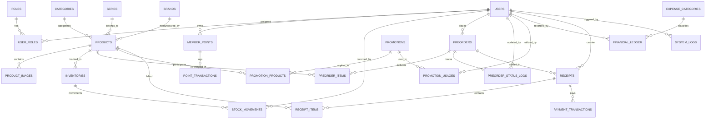

# ข้อกำหนดและโครงสร้างฐานข้อมูล (Database Schema Specification)
## ระบบร้านฟิกเกอร์และโมเดล FriendHouse (CSI402)

เอกสารฉบับนี้จัดทำขึ้นเพื่อระบุโครงสร้างฐานข้อมูลเชิงสัมพันธ์ (Relational Database Schema) สำหรับระบบ **FriendHouse** ครอบคลุมการทำงานทุกส่วนตามโมเดลธุรกิจของร้าน ได้แก่:
1. การจัดการบัญชีและสิทธิ์ผู้ใช้งาน (Identity & Access Management)
2. แคตตาล็อกฟิกเกอร์ สินค้า และมีเดีย 3D (Catalog, Products & Media)
3. การจัดการสต็อก คลังสินค้า และบาร์โค้ด (Inventory, Warehouse & Barcodes)
4. การสั่งจองพรีออเดอร์และการรับมอบสินค้าหน้าร้าน (Pre-orders & Store Pickup)
5. ระบบโปรโมชั่น สิทธิพิเศษ และคะแนนสะสม (Promotions & Loyalty Points)
6. ระบบการเงิน บัญชีรายรับ-รายจ่าย และใบเสร็จ (Finance, Ledger & Receipts)
7. ระบบบันทึกประวัติการทำงานและการตรวจสอบ (System Logs & Audit Trail)

---

## 1. ไดอะแกรมความสัมพันธ์ของข้อมูล (Entity-Relationship Diagram)

---

## 2. รายละเอียดตารางข้อมูล (Data Dictionary & Table Specifications)

### 2.1 กลุ่มข้อมูลผู้ใช้งานและสิทธิ์ (Identity & Access Management)

#### ตาราง: `Roles` (บทบาทผู้ใช้งาน)
เก็บบทบาทหลักในระบบตามโครงสร้างของ FriendHouse
| คอลัมน์ | ชนิดข้อมูล | Constraints | ค่าเริ่มต้น | คำอธิบาย |
| :--- | :--- | :--- | :--- | :--- |
| `RoleId` | INT | PK, IDENTITY(1,1) | - | รหัสบทบาท |
| `RoleCode` | VARCHAR(50) | UNIQUE, NOT NULL | - | รหัสระบบ (`Customer`, `Staff`, `Owner`, `ITSupport`, `Accountant`) |
| `RoleName` | NVARCHAR(100) | NOT NULL | - | ชื่อบทบาทภาษาไทย (เช่น ลูกค้า, พนักงาน, เจ้าของร้าน) |
| `Description` | NVARCHAR(255) | NULL | - | รายละเอียดขอบเขตสิทธิ์ |
| `CreatedAt` | DATETIME2 | NOT NULL | SYSUTCDATETIME() | วันที่สร้างข้อมูล |

#### ตาราง: `Users` (บัญชีผู้ใช้งาน)
| คอลัมน์ | ชนิดข้อมูล | Constraints | ค่าเริ่มต้น | คำอธิบาย |
| :--- | :--- | :--- | :--- | :--- |
| `UserId` | INT | PK, IDENTITY(1,1) | - | รหัสผู้ใช้งาน |
| `UserCode` | VARCHAR(30) | UNIQUE, NOT NULL | - | รหัสประจำตัว (เช่น `USR-CUST-0081`, `USR-STAF-0012`) |
| `Email` | VARCHAR(150) | UNIQUE, NOT NULL | - | อีเมลเข้าสู่ระบบ (ใช้เป็น Username) |
| `PasswordHash` | VARCHAR(255) | NOT NULL | - | รหัสผ่านที่เข้ารหัสแล้ว (BCrypt / PBKDF2) |
| `Phone` | VARCHAR(20) | NOT NULL, INDEX | - | เบอร์โทรศัพท์ (ใช้ค้นหาเคาน์เตอร์รับพรีออเดอร์) |
| `FullName` | NVARCHAR(150) | NULL | - | ชื่อ-นามสกุล (สำหรับ Internal Roles / ลูกค้าเว้นว่างได้) |
| `AvatarUrl` | VARCHAR(255) | NULL | - | ที่อยู่ไฟล์รูปโปรไฟล์ (`/media/images/...`) |
| `IsActive` | BIT | NOT NULL | 1 | สถานะบัญชี (1: ปกติ, 0: ระงับการใช้งาน) |
| `LastLoginAt` | DATETIME2 | NULL | - | วันเวลาที่เข้าสู่ระบบล่าสุด |
| `CreatedAt` | DATETIME2 | NOT NULL | SYSUTCDATETIME() | วันที่ลงทะเบียน |
| `UpdatedAt` | DATETIME2 | NULL | - | วันที่แก้ไขข้อมูลล่าสุด |

#### ตาราง: `UserRoles` (ความสัมพันธ์ผู้ใช้งานกับบทบาท)
| คอลัมน์ | ชนิดข้อมูล | Constraints | คำอธิบาย |
| :--- | :--- | :--- | :--- |
| `UserId` | INT | PK, FK -> `Users(UserId)` | รหัสผู้ใช้งาน (CASCADE DELETE) |
| `RoleId` | INT | PK, FK -> `Roles(RoleId)` | รหัสบทบาท |
| `AssignedAt` | DATETIME2 | NOT NULL, DEFAULT SYSUTCDATETIME() | วันที่มอบหมายสิทธิ์ |

#### ตาราง: `MemberPoints` (ยอดแต้มสะสมสมาชิก)
| คอลัมน์ | ชนิดข้อมูล | Constraints | ค่าเริ่มต้น | คำอธิบาย |
| :--- | :--- | :--- | :--- | :--- |
| `PointId` | INT | PK, IDENTITY(1,1) | - | รหัสตารางแต้ม |
| `UserId` | INT | UNIQUE, FK -> `Users(UserId)` | - | รหัสสมาชิกลูกค้า |
| `CurrentPoints` | INT | NOT NULL, CHECK (>= 0) | 0 | ยอดแต้มสะสมคงเหลือปัจจุบัน |
| `LifetimePoints` | INT | NOT NULL, CHECK (>= 0) | 0 | ยอดแต้มสะสมทั้งหมดที่เคยได้รับ |
| `UpdatedAt` | DATETIME2 | NOT NULL | SYSUTCDATETIME() | วันที่อัปเดตแต้มล่าสุด |

#### ตาราง: `PointTransactions` (ประวัติการได้/ใช้แต้มสะสม)
| คอลัมน์ | ชนิดข้อมูล | Constraints | คำอธิบาย |
| :--- | :--- | :--- | :--- |
| `TransactionId` | BIGINT | PK, IDENTITY(1,1) | รหัสธุรกรรมแต้ม |
| `UserId` | INT | FK -> `Users(UserId)` | รหัสสมาชิก |
| `PointsDelta` | INT | NOT NULL | จำนวนแต้ม (+เมื่อซื้อครบ 100 บาท หรือ x2 โปรโมชั่น, -เมื่อแลกของรางวัล) |
| `BalanceAfter` | INT | NOT NULL | ยอดแต้มคงเหลือหลังทำรายการ |
| `SourceType` | VARCHAR(50) | NOT NULL | แหล่งที่มา (`PurchaseReceipt`, `RewardRedemption`, `AdminAdjustment`) |
| `ReferenceId` | VARCHAR(50) | NULL | รหัสอ้างอิง (เช่น เลขที่ใบเสร็จ หรือ รหัสใบจอง) |
| `Description` | NVARCHAR(255) | NOT NULL | รายละเอียดคำอธิบายรายการ |
| `CreatedAt` | DATETIME2 | NOT NULL, DEFAULT SYSUTCDATETIME() | วันที่บันทึกรายการ |

---

### 2.2 กลุ่มข้อมูลสินค้าและแคตตาล็อก (Catalog, Figures & Media)

#### ตาราง: `Categories` (หมวดหมู่สินค้า)
| คอลัมน์ | ชนิดข้อมูล | Constraints | คำอธิบาย |
| :--- | :--- | :--- | :--- |
| `CategoryId` | INT | PK, IDENTITY(1,1) | รหัสหมวดหมู่ |
| `CategoryName` | NVARCHAR(100) | NOT NULL | ชื่อหมวดหมู่ (เช่น Scale Figures, Nendoroid, Pop Up Parade, กล่องสุ่ม) |
| `Slug` | VARCHAR(100) | UNIQUE, NOT NULL | URL Slug สำหรับค้นหา |
| `IsActive` | BIT | NOT NULL, DEFAULT 1 | สถานะเปิดใช้งาน |

#### ตาราง: `Series` (ซีรีส์ / อนิเมะ / เกม)
| คอลัมน์ | ชนิดข้อมูล | Constraints | คำอธิบาย |
| :--- | :--- | :--- | :--- |
| `SeriesId` | INT | PK, IDENTITY(1,1) | รหัสซีรีส์ |
| `SeriesName` | NVARCHAR(150) | NOT NULL | ชื่อซีรีส์ (เช่น Naruto, Genshin Impact, Spy x Family, One Piece) |
| `Slug` | VARCHAR(150) | UNIQUE, NOT NULL | URL Slug |

#### ตาราง: `Brands` (แบรนด์ผู้ผลิต / ลิขสิทธิ์)
| คอลัมน์ | ชนิดข้อมูล | Constraints | คำอธิบาย |
| :--- | :--- | :--- | :--- |
| `BrandId` | INT | PK, IDENTITY(1,1) | รหัสแบรนด์ |
| `BrandName` | NVARCHAR(100) | NOT NULL | แบรนด์ผู้ผลิต (เช่น Good Smile Company, Kotobukiya, Bandai, Alter) |

#### ตาราง: `Products` (ข้อมูลฟิกเกอร์และโมเดล)
| คอลัมน์ | ชนิดข้อมูล | Constraints | ค่าเริ่มต้น | คำอธิบาย |
| :--- | :--- | :--- | :--- | :--- |
| `ProductId` | INT | PK, IDENTITY(1,1) | - | รหัสสินค้า |
| `Sku` | VARCHAR(50) | UNIQUE, NOT NULL, INDEX | - | รหัส SKU (เช่น `SKU-FG-9901`, `SKU-BB-1042`) |
| `Barcode` | VARCHAR(50) | UNIQUE, NULL, INDEX | - | บาร์โค้ด EAN-13 / QR Code สำหรับสแกน |
| `Name` | NVARCHAR(200) | NOT NULL | - | ชื่อสินค้าภาษาไทย/อังกฤษ |
| `CategoryId` | INT | FK -> `Categories(CategoryId)` | - | หมวดหมู่ |
| `SeriesId` | INT | NULL, FK -> `Series(SeriesId)` | - | ซีรีส์ |
| `BrandId` | INT | NULL, FK -> `Brands(BrandId)` | - | แบรนด์ |
| `Scale` | VARCHAR(30) | NULL | - | สเกล (เช่น 1/7, 1/8, Non-Scale) |
| `HeightCm` | DECIMAL(6,2) | NULL | - | ขนาดความสูง (ซม.) |
| `Material` | NVARCHAR(100) | NULL | - | วัสดุ (เช่น PVC, ABS, Diecast) |
| `RetailPrice` | DECIMAL(10,2) | NOT NULL, CHECK (>= 0) | - | ราคาจำหน่ายหน้าร้านปกติ |
| `PreorderPrice` | DECIMAL(10,2) | NULL, CHECK (>= 0) | - | ราคาจองพิเศษช่วงพรีออเดอร์ |
| `DepositRequired` | DECIMAL(10,2) | NOT NULL, CHECK (>= 0) | 0.00 | ยอดเงินมัดจำขั้นต่ำที่ต้องชำระหน้าร้าน |
| `ExpectedArrival` | NVARCHAR(100) | NULL | - | กำหนดสินค้าเข้าร้านโดยประมาณ |
| `IsPreorder` | BIT | NOT NULL | 0 | เป็นรายการเปิดรับพรีออเดอร์หรือไม่ (1: ใช่, 0: สินค้าพร้อมส่ง) |
| `PreorderDeadline` | DATETIME2 | NULL | - | วันหมดเขตรับสั่งจองพรีออเดอร์ |
| `Model3DPath` | VARCHAR(255) | NULL | - | เส้นทางไฟล์โมเดล 3D (`/media/models/naruto_kyubi_sage.glb`) |
| `IsFeaturedHero` | BIT | NOT NULL | 0 | แสดงที่ส่วนบนสุดของหน้าแรก (Hero Section 3D) หรือไม่ |
| `IsActive` | BIT | NOT NULL | 1 | เปิดแสดงบนหน้าร้าน |
| `CreatedAt` | DATETIME2 | NOT NULL | SYSUTCDATETIME() | วันที่สร้างรายการ |

#### ตาราง: `ProductImages` (รูปภาพประกอบสินค้า)
| คอลัมน์ | ชนิดข้อมูล | Constraints | คำอธิบาย |
| :--- | :--- | :--- | :--- |
| `ImageId` | INT | PK, IDENTITY(1,1) | รหัสรูปภาพ |
| `ProductId` | INT | FK -> `Products(ProductId)` | รหัสสินค้า (CASCADE DELETE) |
| `ImagePath` | VARCHAR(255) | NOT NULL | เส้นทางไฟล์รูปภาพ (`/media/images/hatsune_miku_magical.png`) |
| `IsPrimary` | BIT | NOT NULL, DEFAULT 0 | รูปหน้าปกหลัก |
| `DisplayOrder` | INT | NOT NULL, DEFAULT 0 | ลำดับการแสดงผล |

---

### 2.3 กลุ่มข้อมูลคลังสินค้าและสต็อก (Inventory & Stock Tracking)

#### ตาราง: `Inventories` (สต็อกคงเหลือหน้าร้าน/คลังสินค้า)
| คอลัมน์ | ชนิดข้อมูล | Constraints | ค่าเริ่มต้น | คำอธิบาย |
| :--- | :--- | :--- | :--- | :--- |
| `InventoryId` | INT | PK, IDENTITY(1,1) | - | รหัสสต็อก |
| `ProductId` | INT | UNIQUE, FK -> `Products(ProductId)` | - | รหัสสินค้า |
| `QuantityOnHand` | INT | NOT NULL, CHECK (>= 0) | 0 | จำนวนคงเหลือจริงในร้าน |
| `ReservedQuantity` | INT | NOT NULL, CHECK (>= 0) | 0 | จำนวนที่ถูกลูกค้าจองพรีออเดอร์รอรับ |
| `AvailableQuantity` | AS (`QuantityOnHand` - `ReservedQuantity`) | PERSISTED | - | จำนวนที่พร้อมขายทันทีหน้าร้าน |
| `SafetyStockLevel` | INT | NOT NULL | 3 | ระดับเตือนภัยใกล้หมด (Low stock threshold) |
| `StorageLocation` | NVARCHAR(100) | NULL | - | ตำแหน่งจัดเก็บ (เช่น ชั้นวาง A-01, ตู้โชว์ G-01) |
| `LastRestockedAt` | DATETIME2 | NULL | - | วันเวลาที่รับสินค้าเข้าสต็อกล่าสุด |
| `UpdatedAt` | DATETIME2 | NOT NULL | SYSUTCDATETIME() | วันที่อัปเดตสต็อกล่าสุด |

#### ตาราง: `StockMovements` (ประวัติการเคลื่อนไหวสต็อก เข้า/ออก)
| คอลัมน์ | ชนิดข้อมูล | Constraints | คำอธิบาย |
| :--- | :--- | :--- | :--- |
| `MovementId` | BIGINT | PK, IDENTITY(1,1) | รหัสการเคลื่อนไหว |
| `ProductId` | INT | FK -> `Products(ProductId)` | รหัสสินค้า |
| `MovementType` | VARCHAR(50) | NOT NULL | ประเภท (`ScanReceive`, `StoreSale`, `PreorderPickup`, `Adjustment`, `Return`) |
| `QuantityDelta` | INT | NOT NULL | จำนวนที่เปลี่ยนแปลง (+รับเข้า, -ขายออก/ส่งมอบ) |
| `BalanceAfter` | INT | NOT NULL | จำนวนคงเหลือหลังการเคลื่อนไหว |
| `ReferenceCode` | VARCHAR(50) | NULL | รหัสอ้างอิง (เช่น เลขบิลขาย, เลขใบจอง, หมายเลข Batch) |
| `RecordedByUserId` | INT | FK -> `Users(UserId)` | พนักงานผู้ทำรายการ |
| `Remark` | NVARCHAR(255) | NULL | หมายเหตุเพิ่มเติม |
| `CreatedAt` | DATETIME2 | NOT NULL, DEFAULT SYSUTCDATETIME() | วันเวลาที่ทำรายการ |

---

### 2.4 กลุ่มข้อมูลการสั่งจองพรีออเดอร์ (Pre-orders & Pickup Counter)

#### ตาราง: `Preorders` (คำสั่งจองพรีออเดอร์)
| คอลัมน์ | ชนิดข้อมูล | Constraints | ค่าเริ่มต้น | คำอธิบาย |
| :--- | :--- | :--- | :--- | :--- |
| `PreorderId` | INT | PK, IDENTITY(1,1) | - | รหัสคำสั่งจอง |
| `ReservationNumber` | VARCHAR(30) | UNIQUE, NOT NULL, INDEX | - | หมายเลขอ้างอิงใบจอง (เช่น `#PO-000482`, `DB0123456`) |
| `UserId` | INT | FK -> `Users(UserId)` | - | ลูกค้าผู้สั่งจอง |
| `ContactPhone` | VARCHAR(20) | NOT NULL, INDEX | - | เบอร์โทรศัพท์สำหรับรับ SMS แจ้งเตือน |
| `EstimatedPickupDate` | DATE | NOT NULL | - | วันที่ลูกค้านัดหมายเข้ารับสินค้าที่ร้าน |
| `CurrentStatus` | VARCHAR(50) | NOT NULL | `'PendingConfirm'` | สถานะ (`PendingConfirm`, `WaitingStock`, `ReadyForPickup`, `Completed`, `Cancelled`) |
| `TotalDepositRequired` | DECIMAL(10,2) | NOT NULL | 0.00 | ยอดมัดจำที่ต้องชำระ |
| `TotalDepositPaid` | DECIMAL(10,2) | NOT NULL | 0.00 | ยอดมัดจำที่ชำระแล้วหน้าร้าน |
| `TotalRemainingBalance`| DECIMAL(10,2) | NOT NULL | 0.00 | ยอดคงเหลือที่ต้องชำระเมื่อมารับสินค้า |
| `TotalFinalPrice` | DECIMAL(10,2) | NOT NULL | 0.00 | ยอดราคารวมทั้งหมดของคำสั่งจอง |
| `PickupBranch` | NVARCHAR(100) | NOT NULL | `'FriendHouse HQ'` | สาขาที่นัดรับสินค้า |
| `CreatedAt` | DATETIME2 | NOT NULL | SYSUTCDATETIME() | วันที่ทำรายการจอง |
| `CompletedAt` | DATETIME2 | NULL | - | วันที่ลูกค้ารับสินค้าและปิดบิล |

#### ตาราง: `PreorderItems` (รายการสินค้าในใบจอง)
| คอลัมน์ | ชนิดข้อมูล | Constraints | คำอธิบาย |
| :--- | :--- | :--- | :--- |
| `ItemId` | INT | PK, IDENTITY(1,1) | รหัสรายการในใบจอง |
| `PreorderId` | INT | FK -> `Preorders(PreorderId)` | รหัสใบจอง (CASCADE DELETE) |
| `ProductId` | INT | FK -> `Products(ProductId)` | รหัสสินค้าฟิกเกอร์ |
| `UnitPrice` | DECIMAL(10,2) | NOT NULL | ราคาพรีออเดอร์ต่อหน่วย ณ วันสั่งจอง |
| `DepositPerUnit` | DECIMAL(10,2) | NOT NULL | ยอดมัดจำต่อชิ้น |
| `Quantity` | INT | NOT NULL, CHECK (> 0) | จำนวนที่จอง |
| `LineTotal` | AS (`UnitPrice` * `Quantity`) | PERSISTED | ยอดรวมของแถว |

#### ตาราง: `PreorderStatusLogs` (ประวัติการเปลี่ยนสถานะการจอง)
| คอลัมน์ | ชนิดข้อมูล | Constraints | คำอธิบาย |
| :--- | :--- | :--- | :--- |
| `LogId` | BIGINT | PK, IDENTITY(1,1) | รหัสประวัติสถานะ |
| `PreorderId` | INT | FK -> `Preorders(PreorderId)` | รหัสใบจอง |
| `OldStatus` | VARCHAR(50) | NULL | สถานะก่อนหน้า |
| `NewStatus` | VARCHAR(50) | NOT NULL | สถานะใหม่ที่อัปเดต |
| `ChangedByUserId` | INT | NULL, FK -> `Users(UserId)` | พนักงานผู้อัปเดตสถานะ |
| `Notes` | NVARCHAR(255) | NULL | บันทึกข้อความ (เช่น สินค้าส่งถึงสาขาแล้ว ส่ง SMS เตือนแล้ว) |
| `CreatedAt` | DATETIME2 | NOT NULL, DEFAULT SYSUTCDATETIME() | วันเวลาที่เปลี่ยนสถานะ |

---

### 2.5 กลุ่มข้อมูลโปรโมชั่นและส่วนลด (Promotions & Campaigns)

#### ตาราง: `Promotions` (แคมเปญโปรโมชั่น)
| คอลัมน์ | ชนิดข้อมูล | Constraints | ค่าเริ่มต้น | คำอธิบาย |
| :--- | :--- | :--- | :--- | :--- |
| `PromotionId` | INT | PK, IDENTITY(1,1) | - | รหัสโปรโมชั่น |
| `Name` | NVARCHAR(150) | NOT NULL | - | ชื่อโปรโมชั่น (เช่น ล้างสต๊อกส่งท้ายปี ลด 20–50%) |
| `VoucherCode` | VARCHAR(50) | UNIQUE, NOT NULL, INDEX | - | รหัสโปรโมชั่น (เช่น `CLEARANCE50`, `BOGO2026`) |
| `PromoType` | VARCHAR(50) | NOT NULL | - | รูปแบบ (`percent`, `fixed`, `bogo`, `bundle`, `double_points`) |
| `DiscountValue` | DECIMAL(10,2) | NULL | - | มูลค่าส่วนลด (บาท หรือ %) |
| `MinimumSpend` | DECIMAL(10,2) | NULL | 0.00 | ยอดสั่งซื้อขั้นต่ำที่ได้รับสิทธิ์ |
| `StartDate` | DATE | NOT NULL | - | วันเริ่มต้นโปรโมชั่น |
| `EndDate` | DATE | NOT NULL | - | วันหมดเขตโปรโมชั่น |
| `ApplicableScope`| VARCHAR(50) | NOT NULL | `'all'` | ขอบเขต (`all`, `clearance`, `scale_figures`, `preorder_only`) |
| `UsageLimit` | INT | NULL | - | ขีดจำกัดจำนวนครั้งการใช้งานทั้งหมด (Quota) |
| `CurrentUsageCount`| INT | NOT NULL | 0 | จำนวนครั้งที่มีการใช้สิทธิ์ไปแล้ว |
| `IsActive` | BIT | NOT NULL | 1 | สวิตช์เปิด/ปิดการใช้งานทันที |
| `CreatedAt` | DATETIME2 | NOT NULL | SYSUTCDATETIME() | วันที่สร้างโปรโมชั่น |

#### ตาราง: `PromotionProducts` (สินค้าเฉพาะที่เข้าร่วมโปรโมชั่น)
| คอลัมน์ | ชนิดข้อมูล | Constraints | คำอธิบาย |
| :--- | :--- | :--- | :--- |
| `PromotionId` | INT | PK, FK -> `Promotions(PromotionId)` | รหัสโปรโมชั่น |
| `ProductId` | INT | PK, FK -> `Products(ProductId)` | รหัสสินค้าที่ได้รับส่วนลด |

#### ตาราง: `PromotionUsages` (ประวัติการใช้สิทธิ์โปรโมชั่น)
| คอลัมน์ | ชนิดข้อมูล | Constraints | คำอธิบาย |
| :--- | :--- | :--- | :--- |
| `UsageId` | BIGINT | PK, IDENTITY(1,1) | รหัสการใช้สิทธิ์ |
| `PromotionId` | INT | FK -> `Promotions(PromotionId)` | รหัสโปรโมชั่น |
| `UserId` | INT | FK -> `Users(UserId)` | ลูกค้าที่ใช้สิทธิ์ |
| `ReferenceReceiptNo` | VARCHAR(50) | NULL | เลขที่ใบเสร็จที่ได้ส่วนลด |
| `DiscountApplied` | DECIMAL(10,2) | NOT NULL | จำนวนเงินส่วนลดที่หักออกจริง |
| `UsedAt` | DATETIME2 | NOT NULL, DEFAULT SYSUTCDATETIME() | วันเวลาที่ใช้สิทธิ์ |

---

### 2.6 กลุ่มข้อมูลการเงิน บัญชี และใบเสร็จ (Finance, Ledger & Receipts)

#### ตาราง: `ExpenseCategories` (หมวดหมู่รายจ่าย/รายรับของร้าน)
| คอลัมน์ | ชนิดข้อมูล | Constraints | คำอธิบาย |
| :--- | :--- | :--- | :--- |
| `CategoryId` | INT | PK, IDENTITY(1,1) | รหัสหมวดหมู่ |
| `CategoryName` | NVARCHAR(100) | NOT NULL | ชื่อหมวดหมู่ (ค่าเช่าพื้นที่, ค่าน้ำไฟ, ค่าขนส่ง, ค่ากล่องแพ็คของ, รายรับอื่นๆ) |
| `DefaultType` | VARCHAR(20) | NOT NULL | ประเภทปกติ (`expense` หรือ `income`) |

#### ตาราง: `FinancialLedger` (บันทึกรายรับ-รายจ่ายที่กรอกเอง)
| คอลัมน์ | ชนิดข้อมูล | Constraints | ค่าเริ่มต้น | คำอธิบาย |
| :--- | :--- | :--- | :--- | :--- |
| `EntryId` | INT | PK, IDENTITY(1,1) | - | รหัสบันทึกบัญชี |
| `EntryType` | VARCHAR(20) | NOT NULL | `'expense'` | ประเภท (`expense` หรือ `income`) |
| `CategoryId` | INT | FK -> `ExpenseCategories(CategoryId)` | - | หมวดหมู่บัญชี |
| `Description` | NVARCHAR(255) | NOT NULL | - | รายละเอียดรายการ |
| `Amount` | DECIMAL(12,2) | NOT NULL, CHECK (> 0) | - | จำนวนเงิน (บาท) |
| `EntryDate` | DATE | NOT NULL | - | วันที่เกิดรายการ |
| `RecordedByUserId` | INT | FK -> `Users(UserId)` | - | พนักงาน/นักบัญชีผู้บันทึก |
| `CreatedAt` | DATETIME2 | NOT NULL | SYSUTCDATETIME() | วันเวลาที่บันทึกลงระบบ |
| `UpdatedAt` | DATETIME2 | NULL | - | วันเวลาที่แก้ไข |

#### ตาราง: `Receipts` (ใบเสร็จรับเงินอย่างเป็นทางการ)
| คอลัมน์ | ชนิดข้อมูล | Constraints | ค่าเริ่มต้น | คำอธิบาย |
| :--- | :--- | :--- | :--- | :--- |
| `ReceiptId` | INT | PK, IDENTITY(1,1) | - | รหัสใบเสร็จในระบบ |
| `ReceiptNo` | VARCHAR(40) | UNIQUE, NOT NULL, INDEX | - | เลขที่ใบเสร็จ (เช่น `RC-25690909-0024`) |
| `PreorderId` | INT | NULL, FK -> `Preorders(PreorderId)` | - | เชื่อมโยงกับคำสั่งพรีออเดอร์ (ถ้ามี) |
| `CustomerId` | INT | NULL, FK -> `Users(UserId)` | - | สมาชิกลูกค้า (ถ้าไม่ได้ล็อกอินใช้ชื่อ/เบอร์แทน) |
| `CustomerName` | NVARCHAR(150) | NOT NULL | - | ชื่อลูกค้าที่พิมพ์บนใบเสร็จ |
| `CustomerPhone` | VARCHAR(20) | NOT NULL | - | เบอร์โทรศัพท์ลูกค้า |
| `CashierUserId` | INT | FK -> `Users(UserId)` | - | พนักงานผู้เปิดบิลและรับชำระเงิน |
| `SubtotalAmount`| DECIMAL(10,2) | NOT NULL | - | ยอดรวมก่อนภาษี/ส่วนลด |
| `DiscountAmount`| DECIMAL(10,2) | NOT NULL | 0.00 | ยอดส่วนลดจากโปรโมชั่น |
| `VatAmount` | DECIMAL(10,2) | NOT NULL | - | ภาษีมูลค่าเพิ่ม 7% (รวมในราคา) |
| `NetTotalAmount`| DECIMAL(10,2) | NOT NULL | - | ยอดชำระสุทธิ |
| `PaymentMethod` | VARCHAR(50) | NOT NULL | - | ช่องทางชำระ (`PromptPayQR`, `Cash`, `CreditCard`) |
| `TransactionType`| VARCHAR(50) | NOT NULL | - | ประเภทบิล (`PreorderFinalPickup`, `PreorderDeposit`, `DirectStoreSale`) |
| `BarcodeData` | VARCHAR(100) | NOT NULL | - | ข้อมูลบาร์โค้ดสำหรับเครื่องสแกนบิล |
| `IssuedAt` | DATETIME2 | NOT NULL | SYSUTCDATETIME() | วันเวลาที่ออกใบเสร็จ |

#### ตาราง: `ReceiptItems` (รายการสินค้าในใบเสร็จรับเงิน)
| คอลัมน์ | ชนิดข้อมูล | Constraints | คำอธิบาย |
| :--- | :--- | :--- | :--- |
| `ReceiptItemId` | INT | PK, IDENTITY(1,1) | รหัสรายการ |
| `ReceiptId` | INT | FK -> `Receipts(ReceiptId)` | รหัสใบเสร็จ (CASCADE DELETE) |
| `ProductId` | INT | NULL, FK -> `Products(ProductId)` | รหัสสินค้า |
| `ItemDescription`| NVARCHAR(200) | NOT NULL | ชื่อรายการที่พิมพ์บนบิล |
| `Quantity` | INT | NOT NULL, CHECK (> 0) | จำนวน |
| `UnitPrice` | DECIMAL(10,2) | NOT NULL | ราคาต่อหน่วย |
| `LineTotal` | DECIMAL(10,2) | NOT NULL | ยอดรวมของรายการนี้ |

#### ตาราง: `PaymentTransactions` (ธุรกรรมการชำระเงิน)
| คอลัมน์ | ชนิดข้อมูล | Constraints | คำอธิบาย |
| :--- | :--- | :--- | :--- |
| `PaymentId` | BIGINT | PK, IDENTITY(1,1) | รหัสธุรกรรม |
| `ReceiptId` | INT | FK -> `Receipts(ReceiptId)` | รหัสใบเสร็จ |
| `ProviderTransactionId` | VARCHAR(100) | NULL | รหัสอ้างอิงจากธนาคาร / QR Gateway (เช่น `TXN-0909113012`) |
| `PaymentChannel` | VARCHAR(50) | NOT NULL | ช่องทาง (`PromptPayQR`, `Cash`) |
| `PaidAmount` | DECIMAL(10,2) | NOT NULL | ยอดเงินที่รับชำระ |
| `PaymentStatus` | VARCHAR(30) | NOT NULL | สถานะ (`Completed`, `Pending`, `Failed`, `Refunded`) |
| `PaidAt` | DATETIME2 | NOT NULL, DEFAULT SYSUTCDATETIME() | วันเวลาที่ชำระเงินสำเร็จ |

---

### 2.7 กลุ่มข้อมูลบันทึกระบบและการตรวจสอบ (System Logs & Audit)

#### ตาราง: `SystemLogs` (บันทึกเหตุการณ์และข้อผิดพลาดระบบ)
| คอลัมน์ | ชนิดข้อมูล | Constraints | ค่าเริ่มต้น | คำอธิบาย |
| :--- | :--- | :--- | :--- | :--- |
| `LogId` | BIGINT | PK, IDENTITY(1,1) | - | รหัส Log |
| `LogCode` | VARCHAR(30) | UNIQUE, NOT NULL | - | รหัสเหตุการณ์ (เช่น `LOG-9021`) |
| `LogLevel` | VARCHAR(20) | NOT NULL, INDEX | - | ระดับความสำคัญ (`Info`, `Warning`, `Error`, `Critical`) |
| `Module` | VARCHAR(100) | NOT NULL, INDEX | - | โมดูล/บริการ (เช่น `StockSyncModule`, `AuthModule`, `PreorderService`) |
| `Message` | NVARCHAR(500) | NOT NULL | - | ข้อความเหตุการณ์ |
| `DetailPayload`| NVARCHAR(MAX) | NULL | - | รายละเอียดเชิงเทคนิค / ข้อมูล JSON / Stack Trace |
| `IpAddress` | VARCHAR(50) | NULL | - | IP Address ของเครื่องผู้ส่งคำขอ |
| `UserId` | INT | NULL, FK -> `Users(UserId)` | - | ผู้ใช้งานที่ทำให้เกิดเหตุการณ์ (ถ้ามี) |
| `Timestamp` | DATETIME2 | NOT NULL, INDEX | SYSUTCDATETIME() | วันและเวลาที่เกิดเหตุการณ์ |

---

## 3. ดัชนีเพื่อประสิทธิภาพการทำงาน (Indexes & Performance Optimization)

เพื่อให้ระบบสามารถค้นหาและตอบสนองได้อย่างรวดเร็วแม้มีข้อมูลจำนวนมาก แนะนำให้สร้าง Non-Clustered Indexes ดังนี้:

1. **การค้นหาและเข้าสู่ระบบ**:
   - `CREATE NONCLUSTERED INDEX IX_Users_Email ON Users(Email) INCLUDE (PasswordHash, IsActive);`
   - `CREATE NONCLUSTERED INDEX IX_Users_Phone ON Users(Phone);`
2. **การค้นหาสินค้าและสต็อกหน้าร้าน**:
   - `CREATE NONCLUSTERED INDEX IX_Products_Sku ON Products(Sku);`
   - `CREATE NONCLUSTERED INDEX IX_Products_Barcode ON Products(Barcode) WHERE Barcode IS NOT NULL;`
   - `CREATE NONCLUSTERED INDEX IX_Products_Category ON Products(CategoryId, IsActive);`
3. **การค้นหาคำสั่งพรีออเดอร์ที่เคาน์เตอร์**:
   - `CREATE NONCLUSTERED INDEX IX_Preorders_ReservationPhone ON Preorders(ContactPhone, ReservationNumber) INCLUDE (CurrentStatus, TotalRemainingBalance);`
4. **การตรวจสอบใบเสร็จและรายรับ-รายจ่าย**:
   - `CREATE NONCLUSTERED INDEX IX_Receipts_ReceiptNo ON Receipts(ReceiptNo);`
   - `CREATE NONCLUSTERED INDEX IX_Receipts_IssuedAt ON Receipts(IssuedAt) INCLUDE (NetTotalAmount, PaymentMethod);`
   - `CREATE NONCLUSTERED INDEX IX_FinancialLedger_Date ON FinancialLedger(EntryDate, EntryType);`
5. **การกรอง System Logs**:
   - `CREATE NONCLUSTERED INDEX IX_SystemLogs_Level_Timestamp ON SystemLogs(LogLevel, Timestamp DESC);`

---

## 4. นโยบายการลบข้อมูลและการสำรองข้อมูล (Data Retention & Deletion Policy)
- **Soft Deletes**: ตารางข้อมูลหลัก (`Users`, `Products`, `Promotions`) ให้ใช้การเปลี่ยนสถานะ Flag `IsActive = 0` แทนการลบข้อมูลจริง เพื่อรักษาความสมบูรณ์ของความสัมพันธ์ทางบัญชีและประวัติการสั่งซื้อ (Referential Integrity)
- **Cascade Deletes**: อนุญาตเฉพาะตารางลูกที่ขึ้นตรงกับตารางแม่เท่านั้น เช่น `ReceiptItems` (เมื่อลบใบเสร็จ), `PreorderItems` (เมื่อลบคำสั่งจองร่าง)
- **Audit Logs Retention**: ข้อมูลในตาราง `SystemLogs` ควรตั้งค่า Archive หรือสำรองข้อมูลลง Cold Storage ทุก 90 วัน
