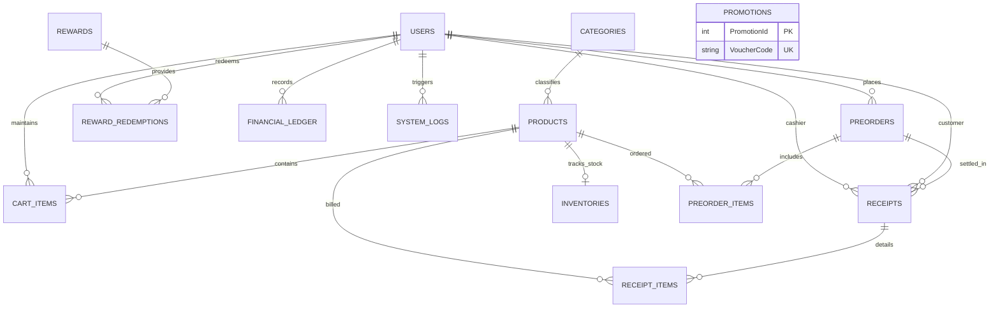

# พจนานุกรมข้อมูล (Data Dictionary)
## ระบบร้านฟิกเกอร์และโมเดล FriendHouse (CSI402)
### เอกสารข้อกำหนดและโครงสร้างข้อมูลระบบฉบับปรับปรุง (Streamlined 14-Table Specification)

---

## 1. บทนำและสถาปัตยกรรมข้อมูล (System Overview & Architecture)

เอกสารฉบับนี้เป็น **พจนานุกรมข้อมูล (Data Dictionary)** สำหรับฐานข้อมูลของระบบร้านค้าฟิกเกอร์และโมเดล **FriendHouse** โครงสร้างได้รับการปรับปรุงให้กระชับ สมเหตุสมผล และตรงกับรูปแบบการทำงานจริงของร้านหน้าร้าน (Physical Store & Counter Service) ทั้งหมด **14 ตารางหลัก**:
- **สิทธิ์และผู้ใช้งาน**: กำหนดให้ 1 บัญชีผู้ใช้งานมีได้เพียง 1 บทบาท (`Role`) ชัดเจน โดยรวมคอลัมน์ `Role` และแต้มสะสม (`Points`) ไว้ในตาราง `Users` ตัวเดียว
- **การจัดการสต็อกและสินค้า**: จัดเก็บแบรนด์และซีรีส์ในตาราง `Products` และแยกตาราง `Inventories` ไว้สำหรับงานนับสต็อกและจำลองการสแกนรับของเข้า (Mock Scan Receive) ของพนักงานหน้าร้าน
- **การชำระเงินและรับสินค้า**: ระบบไม่มี Payment Gateway หรือการชำระเงินออนไลน์ ลูกค้าชำระเงินจริงที่เคาน์เตอร์หน้าร้าน พนักงานตรวจสอบใบจอง กดยืนยันการรับสินค้า กรอกรหัสสมาชิกเพื่อสะสมแต้ม (หรือเลือกข้ามการกรอกได้) และบันทึกเฉพาะตัวเลขยอดเงินที่รับชำระจริงในตาราง `Receipts` โดยไม่ผูกกับรหัสธุรกรรมธนาคารภายนอก

### สภาพแวดล้อมทางเทคนิค
- **ระบบจัดการฐานข้อมูล (RDBMS)**: Microsoft SQL Server 2022 / LocalDB
- **การเข้ารหัสตัวอักษร (Collation)**: `Thai_100_CI_AS`
- **เฟรมเวิร์กเชื่อมต่อข้อมูล (ORM)**: Entity Framework Core 10.0 (ASP.NET Core MVC)
- **มาตรฐานเวลา**: Coordinated Universal Time (UTC) ด้วยชนิดข้อมูล `DATETIME2(7)`
- **นโยบายการลบข้อมูล**: Soft Delete ผ่าน `IsActive` ในตารางหลัก (`Users`, `Products`, `Promotions`)

---

## 2. ไดอะแกรมความสัมพันธ์เชิงข้อมูล (Entity-Relationship Diagram)



---

## 3. สารบัญตารางข้อมูลทั้ง 14 ตาราง (Master Table Index)

| ลำดับ | ชื่อตาราง (Physical Name) | ชื่อภาษาไทย (Logical Name) | กลุ่มงาน (Module) | จำนวนคอลัมน์ | คีย์หลัก (PK) | คำอธิบายโดยย่อ |
| :---: | :--- | :--- | :--- | :---: | :--- | :--- |
| 1 | `Users` | บัญชีผู้ใช้งานระบบ | 1. ผู้ใช้และสมาชิก | 11 | `UserId` | บัญชีผู้ใช้ รวมบทบาท (Role) และแต้มสะสม (Points) ในตัว |
| 2 | `Categories` | หมวดหมู่สินค้า | 2. สินค้าและแคตตาล็อก | 4 | `CategoryId` | หมวดหมู่หลัก เช่น Scale Figures, Nendoroid, กล่องสุ่ม |
| 3 | `Products` | ข้อมูลฟิกเกอร์และโมเดล | 2. สินค้าและแคตตาล็อก | 20 | `ProductId` | รายละเอียดฟิกเกอร์ สเปก ราคา แบรนด์ และซีรีส์ |
| 4 | `Inventories` | คลังสต็อกสินค้าหน้าร้าน | 3. คลังสินค้าและสต็อก | 9 | `InventoryId` | สต็อกสินค้าคงเหลือ ตำแหน่งตู้ และเวลาสแกนรับเข้า |
| 5 | `CartItems` | สินค้าในตะกร้าชั่วคราว | 4. ตะกร้าและพรีออเดอร์ | 5 | `CartItemId` | รายการสินค้าที่ลูกค้าพักไว้ในตะกร้าก่อนกดยืนยันจอง |
| 6 | Preorders | คำสั่งจองพรีออเดอร์ | 4. ตะกร้าและพรีออเดอร์ | 10 | PreorderId | ข้อมูลใบจอง ราคารวม และสถานะการรับของ |
| 7 | `PreorderItems` | รายการฟิกเกอร์ในใบจอง | 4. ตะกร้าและพรีออเดอร์ | 7 | `ItemId` | รายการสินค้า ราคา และจำนวนชิ้นในแต่ละใบสั่งจอง |
| 8 | `Rewards` | ของรางวัลแต้มสะสม | 5. ของรางวัลและแต้ม | 10 | `RewardId` | แคตตาล็อกของพรีเมียมและจำนวนแต้มที่ใช้แลก |
| 9 | `RewardRedemptions` | ประวัติการแลกของรางวัล | 5. ของรางวัลและแต้ม | 9 | `RedemptionId` | ประวัติและรหัสคูปองสำหรับนำไปแสดงรับของที่เคาน์เตอร์ |
| 10 | `Promotions` | แคมเปญโปรโมชั่น 5 รูปแบบ | 6. การตลาดและโปรโมชั่น | 12 | `PromotionId` | โค้ดส่วนลดและกติกาโปรโมชั่นทั้ง 5 รูปแบบของร้าน |
| 11 | `FinancialLedger` | บันทึกบัญชีรายรับ-รายจ่าย | 7. การเงินและใบเสร็จ | 8 | `EntryId` | สมุดรายวันบันทึกค่าใช้จ่ายและรายรับของร้านที่กรอกเอง |
| 12 | `Receipts` | ใบเสร็จรับเงินอย่างเป็นทางการ | 7. การเงินและใบเสร็จ | 12 | `ReceiptId` | ใบเสร็จรับเงินหน้าร้าน ยอดสุทธิ และภาษีมูลค่าเพิ่ม |
| 13 | `ReceiptItems` | รายการสินค้าในใบเสร็จ | 7. การเงินและใบเสร็จ | 7 | `ReceiptItemId` | รายการสินค้าแต่ละบรรทัดที่พิมพ์ลงบนใบเสร็จรับเงิน |
| 14 | `SystemLogs` | บันทึกเหตุการณ์และข้อผิดพลาด | 8. ระบบและความปลอดภัย | 9 | `LogId` | บันทึกเหตุการณ์และกิจกรรมระบบสำหรับฝ่ายไอทีซัพพอร์ต |

---

## 4. รายละเอียดพจนานุกรมข้อมูลรายตาราง (Detailed Table Specifications)

### โมดูลที่ 1: บัญชีผู้ใช้ สิทธิ์ และแต้มสะสม (Identity, Access & Points)

#### 4.1 ตาราง: `Users` (บัญชีผู้ใช้งานระบบ)
- **คำอธิบาย**: จัดเก็บบัญชีผู้ใช้งานระบบทุกกลุ่ม กำหนดให้ 1 บัญชีมีเพียง 1 บทบาทหน้าที่ชัดเจน และจัดเก็บยอดแต้มสะสมในตัว
- **Primary Key**: `UserId` (Clustered)
- **Unique Keys**: `UserCode`, `Email`
- **Non-Clustered Indexes**: `Phone` (ใช้ค้นหาด่วนที่เคาน์เตอร์รับของ), `(Role, IsActive)`

| ลำดับ | ชื่อฟิลด์ (Physical Name) | ชื่อภาษาไทย (Logical Name) | ชนิดข้อมูล (Data Type) | PK/FK | Null? | ค่าเริ่มต้น (Default) | ข้อจำกัด (Constraints) | การเชื่อมโยง UI / ViewModel | คำอธิบาย (Description) | ข้อมูลตัวอย่าง (Example) |
| :---: | :--- | :--- | :--- | :---: | :---: | :--- | :--- | :--- | :--- | :--- |
| 1 | `UserId` | รหัสผู้ใช้งาน | `INT` | **PK** | No | `IDENTITY(1,1)` | Auto Increment (1,1) | `UserProfileViewModel.Id` | รหัสตัวเลขอ้างอิงบัญชีผู้ใช้ | `1` |
| 2 | `UserCode` | รหัสประจำตัวแสดงผล | `VARCHAR(30)` | - | No | - | `UNIQUE` | ป้ายรหัสสมาชิกบนโปรไฟล์ | รหัสประจำตัวสำหรับแสดงผลบนเอกสาร | `'USR-CUST-0081'` |
| 3 | `Email` | อีเมลเข้าสู่ระบบ | `VARCHAR(150)` | - | No | - | `UNIQUE`, Valid Email | `LoginViewModel.Email` | ที่อยู่อีเมลใช้เป็นชื่อผู้ใช้ล็อกอิน | `'sarah.fig@email.com'` |
| 4 | `PasswordHash` | แฮชรหัสผ่านความปลอดภัย | `VARCHAR(255)` | - | No | - | BCrypt Work Factor 12 | `RegisterViewModel.Password` | รหัสผ่านที่เข้ารหัสแฮชความปลอดภัยสูง | `'$2a$12$e8K7b...'` |
| 5 | `Phone` | เบอร์โทรศัพท์ติดต่อ | `VARCHAR(20)` | - | No | - | `INDEX`, ตัวเลข | `RegisterViewModel.Phone` | เบอร์โทรศัพท์สำหรับค้นหาที่เคาน์เตอร์ | `'081-234-5678'` |
| 6 | `FullName` | ชื่อ-นามสกุลจริง | `NVARCHAR(150)` | - | Yes | `NULL` | - | `UserProfileViewModel.Name` | ชื่อ-นามสกุลของพนักงานหรือสมาชิก | `'ณัฐชา ใจดี'` |
| 7 | `AvatarUrl` | เส้นทางรูปโปรไฟล์ | `VARCHAR(255)` | - | Yes | `NULL` | โฟลเดอร์ `media/images` | รูปแสดงบน Navbar และโปรไฟล์ | ที่อยู่ไฟล์รูปภาพประจำตัว | `'/media/images/avatar1.png'` |
| 8 | `Role` | บทบาทหน้าที่ในระบบ | `VARCHAR(30)` | - | No | `'Customer'` | ดู Lookup Code 5.1 | Badge สิทธิ์ในตารางผู้ใช้ | กำหนดบทบาทเดียวชัดเจน (1 คน 1 สิทธิ์) | `'Customer'` |
| 9 | `Points` | แต้มสะสมคงเหลือ | `INT` | - | No | `0` | `CHECK (Points >= 0)` | กล่องแต้มสะสมในหน้า Rewards | แต้มสะสมที่สามารถนำไปแลกของรางวัล | `2450` |
| 10 | `IsActive` | สถานะการเปิดใช้งาน | `BIT` | - | No | `1` | `1=ปกติ, 0=ระงับ` | สวิตช์สถานะในตารางจัดการผู้ใช้ | สถานะความพร้อมใช้งานของบัญชี | `1` |
| 11 | `CreatedAt` | วันเวลาที่ลงทะเบียน | `DATETIME2(7)` | - | No | `SYSUTCDATETIME()` | UTC Standard | คอลัมน์ วันที่สร้าง ในตารางผู้ใช้ | วันและเวลาที่สร้างบัญชีผู้ใช้ในระบบ | `'2026-08-12 10:30:00'` |

---

### โมดูลที่ 2: สินค้า แคตตาล็อก และสต็อก (Catalog, Products & Inventory)

#### 4.2 ตาราง: `Categories` (หมวดหมู่สินค้า)
- **คำอธิบาย**: หมวดหมู่หลักของสินค้าฟิกเกอร์และโมเดลสำหรับจัดกลุ่มและทำตัวกรองบนหน้าร้าน
- **Primary Key**: `CategoryId` (Clustered)
- **Unique Key**: `Slug`

| ลำดับ | ชื่อฟิลด์ (Physical Name) | ชื่อภาษาไทย (Logical Name) | ชนิดข้อมูล (Data Type) | PK/FK | Null? | ค่าเริ่มต้น (Default) | ข้อจำกัด (Constraints) | การเชื่อมโยง UI / ViewModel | คำอธิบาย (Description) | ข้อมูลตัวอย่าง (Example) |
| :---: | :--- | :--- | :--- | :---: | :---: | :--- | :--- | :--- | :--- | :--- |
| 1 | `CategoryId` | รหัสหมวดหมู่สินค้า | `INT` | **PK** | No | `IDENTITY(1,1)` | Auto Increment (1,1) | ตัวกรองหมวดหมู่สินค้า | รหัสระบุหมวดหมู่เฉพาะตัว | `1` |
| 2 | `CategoryName` | ชื่อหมวดหมู่สินค้า | `NVARCHAR(100)` | - | No | - | ข้อความภาษาไทย | แท็บตัวกรองในหน้า Collection | ชื่อเรียกหมวดหมู่สำหรับแสดงผลบน UI | `'Scale Figures'` |
| 3 | `Slug` | รหัสเชื่อมต่อ URL | `VARCHAR(100)` | - | No | - | `UNIQUE`, URL Friendly | Query parameter `?category=...` | รหัสภาษาอังกฤษสำหรับนำทางค้นหา | `'scale-figures'` |
| 4 | `IsActive` | สถานะเปิดใช้งาน | `BIT` | - | No | `1` | `1=แสดง, 0=ซ่อน` | สวิตช์เปิด/ปิดหมวดหมู่ | กำหนดการแสดงผลหมวดหมู่บนหน้าร้าน | `1` |

---

#### 4.3 ตาราง: `Products` (ข้อมูลฟิกเกอร์และโมเดล)
- **คำอธิบาย**: จัดเก็บข้อมูลสเปก ราคา แบรนด์ผู้ผลิต ซีรีส์ และไฟล์มีเดียของสินค้าทุกรายการ
- **Primary Key**: `ProductId` (Clustered)
- **Unique Keys**: `Sku`, `Barcode` (Filtered Unique Where Barcode IS NOT NULL)
- **Non-Clustered Indexes**: `CategoryId`, `(IsPreorder, IsActive)`, `IsFeaturedHero`

| ลำดับ | ชื่อฟิลด์ (Physical Name) | ชื่อภาษาไทย (Logical Name) | ชนิดข้อมูล (Data Type) | PK/FK | Null? | ค่าเริ่มต้น (Default) | ข้อจำกัด (Constraints) | การเชื่อมโยง UI / ViewModel | คำอธิบาย (Description) | ข้อมูลตัวอย่าง (Example) |
| :---: | :--- | :--- | :--- | :---: | :---: | :--- | :--- | :--- | :--- | :--- |
| 1 | `ProductId` | รหัสสินค้าประจำระบบ | `INT` | **PK** | No | `IDENTITY(1,1)` | Auto Increment (1,1) | `ProductItemDto.Id` | รหัสระบุสินค้าตัวเลขหลัก | `101` |
| 2 | `Sku` | รหัสสต็อก SKU ประจำชิ้น | `VARCHAR(50)` | - | No | - | `UNIQUE, INDEX` | `StockItemDto.Sku` | รหัสสต็อกสินค้ามาตรฐานภายในร้าน | `'SKU-FG-9901'` |
| 3 | `Barcode` | รหัสบาร์โค้ดสแกน | `VARCHAR(50)` | - | Yes | `NULL` | `UNIQUE, INDEX` | `ScanReceiveInputDto.Sku` | รหัสแท่ง EAN-13 หรือ QR Code บนกล่อง | `'8851234567890'` |
| 4 | `Name` | ชื่อสินค้าเต็ม | `NVARCHAR(200)` | - | No | - | สองภาษา | หัวข้อหลักใน `ProductDetail` | ชื่อรุ่นและตัวละครของฟิกเกอร์ | `'Hatsune Miku - Magical Mirai 2024'` |
| 5 | `CategoryId` | รหัสหมวดหมู่สินค้า | `INT` | **FK** | No | - | `FK -> Categories` | ป้ายหมวดหมู่บนการ์ดสินค้า | หมวดหมู่สินค้าที่สังกัด | `1` |
| 6 | `SeriesName` | ชื่อซีรีส์ / อนิเมะ | `NVARCHAR(150)` | - | Yes | `NULL` | - | ป้ายชื่อเรื่องใต้ชื่อสินค้า | ซีรีส์หรือเกมต้นสังกัดของตัวละคร | `'Vocaloid'` |
| 7 | `BrandName` | แบรนด์ผู้ผลิต / ลิขสิทธิ์ | `NVARCHAR(100)` | - | Yes | `NULL` | - | ตารางสเปกสินค้าหน้า ProductDetail | ค่ายผู้ผลิตที่ถือลิขสิทธิ์ฟิกเกอร์แท้ | `'Good Smile Company'` |
| 8 | `Scale` | สัดส่วนสเกลฟิกเกอร์ | `VARCHAR(30)` | - | Yes | `NULL` | เช่น 1/7, Non-Scale | ตารางสเปกสินค้า | อัตราส่วนขนาดเทียบกับสัดส่วนจริง | `'1/7'` |
| 9 | `HeightCm` | ความสูงของโมเดล (ซม.) | `DECIMAL(6,2)` | - | Yes | `NULL` | `CHECK (HeightCm > 0)` | ตารางสเปกสินค้า | ความสูงโดยประมาณตั้งแต่ฐานถึงจุดสูงสุด | `24.50` |
| 10 | `Material` | วัสดุหลักที่ใช้ผลิต | `NVARCHAR(100)` | - | Yes | `NULL` | - | ตารางสเปกสินค้า | ชนิดพลาสติกหรือวัสดุหลัก | `'PVC, ABS'` |
| 11 | `RetailPrice` | ราคาจำหน่ายปกติ (บาท) | `DECIMAL(10,2)` | - | No | - | `CHECK (RetailPrice >= 0)` | ป้ายราคาหลักบนการ์ดสินค้า | ราคาเต็มเมื่อวางจำหน่ายหน้าร้าน | `4200.00` |
| 12 | `PreorderPrice` | ราคาพิเศษช่วงพรีออเดอร์ | `DECIMAL(10,2)` | - | Yes | `NULL` | `CHECK (PreorderPrice >= 0)`| ป้ายราคาพิเศษสีแดงช่วงเปิดจอง | ราคาลดพิเศษสำหรับผู้สั่งจองล่วงหน้า | `3990.00` |
| 13 | `ExpectedArrival`| กำหนดสินค้าเข้าร้าน | `NVARCHAR(100)` | - | Yes | `NULL` | ข้อความไตรมาส/ปี | ป้ายกำหนดสินค้าเข้าร้านบนการ์ด | กำหนดการสินค้าเดินทางถึงสาขาโดยประมาณ | `'ไตรมาส 4 ปี 2569'` |
| 14 | `IsPreorder` | สถานะเปิดพรีออเดอร์ | `BIT` | - | No | `0` | `1=พรีออเดอร์, 0=พร้อมส่ง` | Badge 'พรีออเดอร์' บนการ์ดสินค้า | แยกสินค้าระหว่างสินค้าสั่งจองกับของพร้อมส่ง | `1` |
| 15 | `PreorderDeadline`| วันหมดเขตรับสั่งจอง | `DATETIME2(7)` | - | Yes | `NULL` | UTC Standard | ตัวนับเวลาถอยหลังปิดรับจอง | วันและเวลาสิ้นสุดการรับสั่งจองล่วงหน้า | `'2026-10-31 23:59:59'` |
| 16 | `ImageUrl` | รูปภาพหลักของสินค้า | `VARCHAR(255)` | - | No | - | โฟลเดอร์ `media/images` | แท็ก `` บน UI | ที่อยู่ไฟล์ภาพหน้าปกหลักของสินค้า | `'/media/images/hatsune_miku_magical.png'` |
| 17 | `Model3DPath` | เส้นทางไฟล์โมเดล 3D | `VARCHAR(255)` | - | Yes | `NULL` | โฟลเดอร์ `media/models` | แอตทริบิวต์ `src` ใน `<model-viewer>` | ที่อยู่ไฟล์ 3D เสมือนจริงสกุล `.glb` | `'/media/models/naruto_kyubi_sage.glb'` |
| 18 | `IsFeaturedHero` | แสดงผลบนส่วน Hero 3D | `BIT` | - | No | `0` | `1=แสดง Hero, 0=ปกติ` | ส่วนหัวหน้าแรกของร้าน | สวิตช์เลือกสินค้าขึ้นแสดงแบบ 3D บนหน้าแรก | `1` |
| 19 | `IsActive` | สถานะการเปิดขาย | `BIT` | - | No | `1` | `1=ขาย, 0=ระงับการขาย` | สวิตช์เปิด/ปิดสินค้า | การเปิดแสดงผลให้ลูกค้าค้นหาและสั่งจอง | `1` |
| 20 | `CreatedAt` | วันเวลาที่สร้างรายการ | `DATETIME2(7)` | - | No | `SYSUTCDATETIME()` | UTC Standard | - | วันเวลาที่บันทึกสินค้าเข้าระบบ | `'2026-08-01 10:00:00'` |

---

#### 4.4 ตาราง: `Inventories` (คลังสต็อกสินค้าหน้าร้าน)
- **คำอธิบาย**: จัดการยอดสต็อกสินค้าคงเหลือจริง ตำแหน่งจัดเก็บหน้าร้าน และรองรับการจำลองสแกนรับสินค้าเข้า (Mock Scan Receive)
- **Primary Key**: `InventoryId` (Clustered)
- **Unique / Foreign Key**: `ProductId` -> `Products(ProductId)`
- **Computed Column**: `AvailableQuantity = (QuantityOnHand - ReservedQuantity)`

| ลำดับ | ชื่อฟิลด์ (Physical Name) | ชื่อภาษาไทย (Logical Name) | ชนิดข้อมูล (Data Type) | PK/FK | Null? | ค่าเริ่มต้น (Default) | ข้อจำกัด (Constraints) | การเชื่อมโยง UI / ViewModel | คำอธิบาย (Description) | ข้อมูลตัวอย่าง (Example) |
| :---: | :--- | :--- | :--- | :---: | :---: | :--- | :--- | :--- | :--- | :--- |
| 1 | `InventoryId` | รหัสระเบียนสต็อก | `INT` | **PK** | No | `IDENTITY(1,1)` | Auto Increment (1,1) | - | รหัสอ้างอิงสต็อกสินค้า | `1` |
| 2 | `ProductId` | รหัสสินค้า | `INT` | **FK** | No | - | `UNIQUE, FK -> Products` | `StockItemDto.Id` | รหัสสินค้าที่นับสต็อก (1:1) | `101` |
| 3 | `QuantityOnHand`| ยอดคงเหลือจริงในร้าน | `INT` | - | No | `0` | `CHECK (QuantityOnHand >= 0)` | `StockItemDto.CurrentQuantity` | จำนวนกล่องที่มีอยู่ในร้านจริงทั้งหมด | `12` |
| 4 | `ReservedQuantity`| จำนวนที่ติดจองพรีออเดอร์| `INT` | - | No | `0` | `CHECK (ReservedQuantity >= 0)`| ยอดสินค้าที่รอลูกค้ามารับ | จำนวนกล่องที่ถูกจองแล้วและห้ามขาย | `4` |
| 5 | `AvailableQuantity`| จำนวนพร้อมขายหน้าร้าน | `INT` | - | No | `PERSISTED` | `AS (QuantityOnHand - Reserved)`| ป้ายแสดงสถานะ 'พร้อมส่ง X ชิ้น' | จำนวนที่เหลือสำหรับขายให้ลูกค้าทั่วไป | `8` |
| 6 | `SafetyStockLevel`| เกณฑ์แจ้งเตือนสต็อกต่ำ | `INT` | - | No | `3` | `CHECK (SafetyLevel >= 0)` | `StockItemDto.SafetyThreshold` | จุดเตือนเมื่อสินค้าใกล้หมดร้าน | `3` |
| 7 | `StorageLocation`| ตำแหน่งจัดเก็บในร้าน | `NVARCHAR(100)`| - | Yes | `NULL` | - | `StockItemDto.StorageLocation` | ตู้โชว์ ชั้นวาง หรือห้องสต็อกหลังร้าน | `'ตู้โชว์กระจก G-01'` |
| 8 | `LastRestockedAt`| วันเวลาสแกนรับเข้าล่าสุด| `DATETIME2(7)` | - | Yes | `NULL` | UTC Standard | `StockItemDto.LastReceivedDate` | วันที่พนักงานสแกน QR รับของเข้าล่าสุด | `'2026-09-04 14:28:00'` |
| 9 | `UpdatedAt` | วันเวลาปรับปรุงสต็อก | `DATETIME2(7)` | - | No | `SYSUTCDATETIME()` | UTC Standard | - | วันเวลาที่ยอดสต็อกมีการขยับล่าสุด | `'2026-09-09 14:15:00'` |

---

### โมดูลที่ 3: ตะกร้าสินค้าและการสั่งจองพรีออเดอร์ (Cart & Preorders)

#### 4.5 ตาราง: `CartItems` (สินค้าในตะกร้าชั่วคราว)
- **คำอธิบาย**: บันทึกรายการสินค้าที่สมาชิกลูกค้าเลือกไว้ในหน้า `Views/Home/Cart.cshtml` ก่อนกดยืนยันสั่งจอง
- **Primary Key**: `CartItemId` (Clustered)
- **Foreign Keys**: `UserId` -> `Users(UserId)`, `ProductId` -> `Products(ProductId)`
- **Unique Key**: `(UserId, ProductId)`

| ลำดับ | ชื่อฟิลด์ (Physical Name) | ชื่อภาษาไทย (Logical Name) | ชนิดข้อมูล (Data Type) | PK/FK | Null? | ค่าเริ่มต้น (Default) | ข้อจำกัด (Constraints) | การเชื่อมโยง UI / ViewModel | คำอธิบาย (Description) | ข้อมูลตัวอย่าง (Example) |
| :---: | :--- | :--- | :--- | :---: | :---: | :--- | :--- | :--- | :--- | :--- |
| 1 | `CartItemId` | รหัสรายการในตะกร้า | `INT` | **PK** | No | `IDENTITY(1,1)` | Auto Increment (1,1) | รายการในหน้า `Cart.cshtml` | รหัสแถวรายการสินค้าในตะกร้า | `1` |
| 2 | `UserId` | รหัสลูกค้าเจ้าของตะกร้า | `INT` | **FK** | No | - | `FK -> Users(UserId)` | ลูกค้าที่กำลังเข้าสู่ระบบ | บัญชีผู้ใช้ที่เลือกสินค้านี้ | `1` |
| 3 | `ProductId` | รหัสสินค้าที่เลือก | `INT` | **FK** | No | - | `FK -> Products(ProductId)` | รายการฟิกเกอร์ในตะกร้า | ฟิกเกอร์ที่ต้องการสั่งพรีออเดอร์ | `101` |
| 4 | `Quantity` | จำนวนชิ้นที่ระบุ | `INT` | - | No | `1` | `CHECK (Quantity > 0)` | กล่องปรับตัวเลขจำนวนชิ้น (+/-) | จำนวนสินค้าที่ต้องการสั่งในรายการนี้ | `1` |
| 5 | `CreatedAt` | วันเวลาที่เพิ่มลงตะกร้า | `DATETIME2(7)` | - | No | `SYSUTCDATETIME()` | UTC Standard | - | วันเวลาที่ลูกค้ากดเพิ่มลงตะกร้า | `'2026-09-09 10:15:00'` |

---

#### 4.6 ตาราง: `Preorders` (คำสั่งจองพรีออเดอร์)
- **คำอธิบาย**: บันทึกคำสั่งจองฟิกเกอร์ล่วงหน้าของลูกค้า กำหนดนัดรับ ราคาสุทธิ และสถานะการจัดเตรียมของหน้าร้าน
- **Primary Key**: `PreorderId` (Clustered)
- **Unique Key**: `ReservationNumber`
- **Non-Clustered Indexes**: `ContactPhone`, `(CurrentStatus, EstimatedPickupDate)`

| ลำดับ | ชื่อฟิลด์ (Physical Name) | ชื่อภาษาไทย (Logical Name) | ชนิดข้อมูล (Data Type) | PK/FK | Null? | ค่าเริ่มต้น (Default) | ข้อจำกัด (Constraints) | การเชื่อมโยง UI / ViewModel | คำอธิบาย (Description) | ข้อมูลตัวอย่าง (Example) |
| :---: | :--- | :--- | :--- | :---: | :---: | :--- | :--- | :--- | :--- | :--- |
| 1 | `PreorderId` | รหัสคำสั่งจองภายใน | `INT` | **PK** | No | `IDENTITY(1,1)` | Auto Increment (1,1) | - | รหัสอ้างอิงลำดับที่ของคำสั่งจอง | `482` |
| 2 | `ReservationNumber`| เลขที่อ้างอิงใบจอง | `VARCHAR(30)` | - | No | - | `UNIQUE, INDEX` | `CounterPreorderViewModel.ReservationNumber` | รหัสใบจองที่ส่งให้ลูกค้าติดตามสถานะ | `'PO-000482'` |
| 3 | `UserId` | รหัสลูกค้าผู้สั่งจอง | `INT` | **FK** | No | - | `FK -> Users(UserId)` | แสดงในข้อมูลผู้จองที่เคาน์เตอร์ | สมาชิกเจ้าของคำสั่งจอง | `1` |
| 4 | `ContactPhone` | เบอร์โทรศัพท์นัดรับ | `VARCHAR(20)` | - | No | - | `INDEX`, รูปแบบตัวเลข | ช่องค้นหาที่เคาน์เตอร์พนักงาน | เบอร์โทรศัพท์สำหรับค้นหาและส่ง SMS แจ้ง | `'081-234-5000'` |
| 5 | `EstimatedPickupDate`| วันที่สะดวกเข้ารับสินค้า| `DATE` | - | No | - | วันที่ในอนาคต | `PreorderBookingDto.PickupDate` | วันที่ลูกค้าระบุว่าจะเข้ามารับสินค้าที่ร้าน | `'2026-11-15'` |
| 6 | `CurrentStatus` | สถานะปัจจุบันของใบจอง | `VARCHAR(50)` | - | No | `'PendingConfirm'` | ดู Lookup Code 5.2 | แถบ Step Indicator 4 ขั้นตอน | สถานะความคืบหน้าของสินค้าพรีออเดอร์ | `'ReadyForPickup'` |
| 7 | `TotalFinalPrice` | ราคารวมสุทธิทั้งหมด | `DECIMAL(10,2)`| - | No | - | `CHECK (FinalPrice >= 0)`| ยอดราคารวมทั้งหมดของใบจอง | มูลค่าสินค้าทั้งหมดตามใบสั่งจอง | `4200.00` |
| 8 | `PickupBranch` | สาขาที่นัดรับสินค้า | `NVARCHAR(100)`| - | No | `'FriendHouse HQ'` | - | ป้ายสาขาบนการ์ดสถานะใบจอง | สาขาของร้านที่ลูกค้านัดหมายเข้ารับ | `'FriendHouse HQ'` |
| 9 | `CreatedAt` | วันเวลาที่ยืนยันการจอง | `DATETIME2(7)` | - | No | `SYSUTCDATETIME()` | UTC Standard | วันที่ออกใบจองในหน้าติดตาม | วันและเวลาที่ส่งคำสั่งจองเข้าสู่ระบบ | `'2026-08-28 16:45:00'` |
| 10 | `CompletedAt` | วันเวลาที่รับของปิดบิล | `DATETIME2(7)` | - | Yes | `NULL` | UTC Standard | วันเวลาที่ปิดงานในใบเสร็จ | วันเวลาที่ลูกค้ารับของและชำระครบถ้วน | `'2026-09-09 14:15:00'` |

---

#### 4.7 ตาราง: `PreorderItems` (รายการฟิกเกอร์ในใบจอง)
- **คำอธิบาย**: รายการสินค้า ราคาต่อหน่วย และจำนวนชิ้นในแต่ละคำสั่งจองพรีออเดอร์
- **Primary Key**: `ItemId` (Clustered)
- **Foreign Keys**: `PreorderId` -> `Preorders(PreorderId)` (CASCADE), `ProductId` -> `Products(ProductId)`
- **Computed Column**: `LineTotal = (UnitPrice * Quantity)`

| ลำดับ | ชื่อฟิลด์ (Physical Name) | ชื่อภาษาไทย (Logical Name) | ชนิดข้อมูล (Data Type) | PK/FK | Null? | ค่าเริ่มต้น (Default) | ข้อจำกัด (Constraints) | การเชื่อมโยง UI / ViewModel | คำอธิบาย (Description) | ข้อมูลตัวอย่าง (Example) |
| :---: | :--- | :--- | :--- | :---: | :---: | :--- | :--- | :--- | :--- | :--- |
| 1 | `ItemId` | รหัสรายการในใบจอง | `INT` | **PK** | No | `IDENTITY(1,1)` | Auto Increment (1,1) | - | รหัสแถวรายการสินค้าในใบจอง | `1` |
| 2 | `PreorderId` | รหัสใบจองหลัก | `INT` | **FK** | No | - | `FK -> Preorders` (Cascade) | รหัสคำสั่งจองอ้างอิง | รหัสคำสั่งจองพรีออเดอร์ที่สังกัด | `482` |
| 3 | `ProductId` | รหัสสินค้าที่สั่งจอง | `INT` | **FK** | No | - | `FK -> Products(ProductId)` | รายการฟิกเกอร์ที่แสดงในการ์ดผลลัพธ์ | รหัสฟิกเกอร์ที่ลูกค้าทำการสั่งจอง | `101` |
| 4 | `UnitPrice` | ราคาต่อหน่วย ณ วันสั่งจอง | `DECIMAL(10,2)`| - | No | - | `CHECK (UnitPrice >= 0)` | ราคาต่อชิ้นที่แสดงในตาราง | ราคาของสินค้าต่อชิ้นที่ล็อคไว้ ณ วันจอง | `4200.00` |
| 5 | `Quantity` | จำนวนชิ้นที่สั่งจอง | `INT` | - | No | `1` | `CHECK (Quantity > 0)` | ตัวเลขจำนวนชิ้นในรายการ | จำนวนสินค้าที่ลูกค้าจองในรายการนี้ | `1` |
| 6 | `LineTotal` | ราคารวมของรายการนี้ | `DECIMAL(10,2)`| - | No | `PERSISTED` | `AS (UnitPrice * Quantity)` | ราคารวมประจำแถวสินค้า | มูลค่ารวมของแถวสินค้าคำนวณอัตโนมัติ | `4200.00` |

---

### โมดูลที่ 4: ของรางวัลสะสมแต้ม (Loyalty Rewards & Redemptions)

#### 4.8 ตาราง: `Rewards` (ของรางวัลแต้มสะสม)
- **คำอธิบาย**: รายการของพรีเมียมและของสะสมที่ลูกค้าสามารถใช้แต้มสะสมแลกได้ ในหน้า `Views/Home/Rewards.cshtml`
- **Primary Key**: `RewardId` (Clustered)
- **Unique Key**: `RewardCode`

| ลำดับ | ชื่อฟิลด์ (Physical Name) | ชื่อภาษาไทย (Logical Name) | ชนิดข้อมูล (Data Type) | PK/FK | Null? | ค่าเริ่มต้น (Default) | ข้อจำกัด (Constraints) | การเชื่อมโยง UI / ViewModel | คำอธิบาย (Description) | ข้อมูลตัวอย่าง (Example) |
| :---: | :--- | :--- | :--- | :---: | :---: | :--- | :--- | :--- | :--- | :--- |
| 1 | `RewardId` | รหัสของรางวัล | `INT` | **PK** | No | `IDENTITY(1,1)` | Auto Increment (1,1) | การ์ดของรางวัลในหน้า `Rewards` | รหัสอ้างอิงของรางวัล | `301` |
| 2 | `RewardCode` | รหัสอ้างอิงของรางวัล | `VARCHAR(30)` | - | No | - | `UNIQUE` | รหัสสินค้าของขวัญ | รหัสตัวอักษรของรางวัล | `'RWD-KEY-DEMON'` |
| 3 | `Title` | ชื่อของรางวัล | `NVARCHAR(150)` | - | No | - | ข้อความภาษาไทย | ชื่อหลักบนการ์ดของรางวัล | ชื่อของพรีเมียมหรือรางวัล | `'พวงกุญแจอะคริลิก ดาบพิฆาตอสูร Special Ver.'` |
| 4 | `Brand` | แบรนด์ผู้ผลิตของรางวัล | `NVARCHAR(100)` | - | Yes | `NULL` | - | ป้ายค่ายผลิตบนการ์ด | แบรนด์หรือลิขสิทธิ์ของพรีเมียม | `'Banpresto'` |
| 5 | `CategoryTag` | ป้ายหมวดหมู่ของรางวัล | `NVARCHAR(50)` | - | No | `'Merchandise'` | - | ป้าย Tag มุมขวาบน (Limited, ยอดนิยม) | หมวดของรางวัลสำหรับกรอง | `'พรีเมียมกิ๊ฟ (Merchandise)'` |
| 6 | `PointsRequired` | แต้มสะสมที่ต้องใช้แลก | `INT` | - | No | - | `CHECK (Points > 0)` | ตัวเลขแต้มสีน้ำเงิน '350 แต้ม' | จำนวนแต้มสะสมที่ต้องหักออกจากบัญชี | `350` |
| 7 | `StockQuantity` | จำนวนคงเหลือในสต็อก | `INT` | - | No | `0` | `CHECK (Stock >= 0)` | ป้ายกำกับ 'แลกได้ทันที' หรือ 'หมด' | จำนวนชิ้นของรางวัลที่พร้อมส่งมอบ | `25` |
| 8 | `ImageUrl` | เส้นทางรูปภาพของรางวัล | `VARCHAR(255)` | - | No | - | โฟลเดอร์ `media/images` | แท็กภาพของรางวัลในการ์ด | ที่อยู่ไฟล์ภาพของรางวัล | `'/media/images/tanjiro_kamado.png'` |
| 9 | `IsAvailable` | สถานะเปิดให้แลก | `BIT` | - | No | `1` | `1=แลกได้, 0=ปิดการแลก` | ปุ่ม 'แลกรับรางวัล' (Active/Disabled) | กำหนดความพร้อมในการเปิดให้แลก | `1` |
| 10 | `CreatedAt` | วันเวลาที่เพิ่มรางวัล | `DATETIME2(7)` | - | No | `SYSUTCDATETIME()` | UTC Standard | - | วันเวลาที่ลงทะเบียนรางวัลเข้าสู่ระบบ | `'2026-08-15 10:00:00'` |

---

#### 4.9 ตาราง: `RewardRedemptions` (ประวัติการแลกของรางวัล)
- **คำอธิบาย**: บันทึกการใช้แต้มแลกรางวัล และออกรหัสคูปองเพื่อนำไปแสดงให้พนักงานที่เคาน์เตอร์ส่งมอบของ
- **Primary Key**: `RedemptionId` (Clustered)
- **Unique Key**: `RedemptionCode`
- **Foreign Keys**: `UserId` -> `Users(UserId)`, `RewardId` -> `Rewards(RewardId)`

| ลำดับ | ชื่อฟิลด์ (Physical Name) | ชื่อภาษาไทย (Logical Name) | ชนิดข้อมูล (Data Type) | PK/FK | Null? | ค่าเริ่มต้น (Default) | ข้อจำกัด (Constraints) | การเชื่อมโยง UI / ViewModel | คำอธิบาย (Description) | ข้อมูลตัวอย่าง (Example) |
| :---: | :--- | :--- | :--- | :---: | :---: | :--- | :--- | :--- | :--- | :--- |
| 1 | `RedemptionId` | รหัสรายการแลกรางวัล | `BIGINT` | **PK** | No | `IDENTITY(1,1)` | Auto Increment (1,1) | - | รหัสระเบียนการแลกรางวัล | `201` |
| 2 | `RedemptionCode` | รหัสรับของรางวัล | `VARCHAR(40)` | - | No | - | `UNIQUE, INDEX` | `CounterPreorderViewModel.RedemptionNumber` | รหัสคูปองแสดงให้พนักงานตรวจสอบ | `'RDM-20260909-001'` |
| 3 | `UserId` | รหัสลูกค้าผู้ใช้แต้มแลก | `INT` | **FK** | No | - | `FK -> Users(UserId)` | ข้อมูลลูกค้าในประวัติการแลก | สมาชิกผู้กดแลกของรางวัล | `1` |
| 4 | `RewardId` | รหัสของรางวัลที่ได้รับ | `INT` | **FK** | No | - | `FK -> Rewards(RewardId)` | ข้อมูลของรางวัลที่ต้องส่งมอบหน้าร้าน | รางวัลที่ทำการขอแลก | `301` |
| 5 | `PointsSpent` | จำนวนแต้มที่ถูกหักออก | `INT` | - | No | - | `CHECK (PointsSpent > 0)` | บรรทัดแต้มที่ถูกหักในบัญชี | แต้มสะสมที่ถูกตัดออกจากยอดคงเหลือ | `350` |
| 6 | `Status` | สถานะการรับของรางวัล | `VARCHAR(30)` | - | No | `'PendingPickup'` | ดู Lookup Code 5.3 | ป้ายสถานะ 'รอรับที่เคาน์เตอร์' | ความคืบหน้าการส่งมอบของรางวัล | `'PendingPickup'` |
| 7 | `PickupBranch` | สาขาที่สะดวกรับของขวัญ | `NVARCHAR(100)`| - | No | `'FriendHouse HQ'` | - | สาขานัดรับของรางวัล | สาขาของร้านที่ลูกค้าระบุรับของ | `'FriendHouse HQ'` |
| 8 | `RedeemedAt` | วันเวลาที่กดแลกแต้ม | `DATETIME2(7)` | - | No | `SYSUTCDATETIME()` | UTC Standard | วันเวลาที่แลกในหน้าประวัติ | วันเวลาที่ลูกค้ายืนยันการแลกแต้ม | `'2026-09-09 11:30:00'` |
| 9 | `CompletedAt` | วันเวลาที่รับของจริง | `DATETIME2(7)` | - | Yes | `NULL` | UTC Standard | วันที่ปิดรายการที่เคาน์เตอร์ | วันเวลาที่พนักงานส่งมอบของและปิดบิล | `'2026-09-09 14:15:00'` |

---

### โมดูลที่ 5: การตลาดและโปรโมชั่น (Marketing & Promotions)

#### 4.10 ตาราง: `Promotions` (แคมเปญโปรโมชั่น 5 รูปแบบ)
- **คำอธิบาย**: จัดเก็บแคมเปญโปรโมชั่น 5 รูปแบบของร้าน FriendHouse (เปอร์เซ็นต์, จำนวนเงินคงที่, ซื้อ 1 แถม 1, เซ็ตคู่ดูโอ้, แต้มสะสมคูณสอง) ที่หน้า `Views/Owner/Promotions.cshtml`
- **Primary Key**: `PromotionId` (Clustered)
- **Unique Key**: `VoucherCode`

| ลำดับ | ชื่อฟิลด์ (Physical Name) | ชื่อภาษาไทย (Logical Name) | ชนิดข้อมูล (Data Type) | PK/FK | Null? | ค่าเริ่มต้น (Default) | ข้อจำกัด (Constraints) | การเชื่อมโยง UI / ViewModel | คำอธิบาย (Description) | ข้อมูลตัวอย่าง (Example) |
| :---: | :--- | :--- | :--- | :---: | :---: | :--- | :--- | :--- | :--- | :--- |
| 1 | `PromotionId` | รหัสโปรโมชั่น | `INT` | **PK** | No | `IDENTITY(1,1)` | Auto Increment (1,1) | `EditPromotionViewModel.Id` | รหัสระบุแคมเปญโปรโมชั่น | `1` |
| 2 | `Name` | ชื่อโปรโมชั่น | `NVARCHAR(150)` | - | No | - | ข้อความภาษาไทย | `CreatePromotionViewModel.Name` | ชื่อแคมเปญแสดงบนแบนเนอร์และรายการ | `'ล้างสต๊อกส่งท้ายปี ลด 20–50%'` |
| 3 | `VoucherCode` | รหัสคูปอง / โค้ดส่วนลด | `VARCHAR(50)` | - | No | - | `UNIQUE, INDEX` | `CreatePromotionViewModel.Code` | รหัสสำหรับกรอกเพื่อรับสิทธิ์ | `'CLEARANCE50'` |
| 4 | `PromoType` | รูปแบบประเภทโปรโมชั่น | `VARCHAR(50)` | - | No | - | ดู Lookup Code 5.4 | `CreatePromotionViewModel.PromoType` | 1 ใน 5 รูปแบบโปรโมชั่นของร้าน | `'percent'` |
| 5 | `DiscountValue` | มูลค่าส่วนลด | `DECIMAL(10,2)`| - | Yes | `NULL` | `CHECK (Value >= 0)` | `CreatePromotionViewModel.DiscountValue`| มูลค่าเป็นเปอร์เซ็นต์หรือจำนวนเงินบาท | `50.00` |
| 6 | `MinimumSpend` | ยอดสั่งซื้อขั้นต่ำ | `DECIMAL(10,2)`| - | Yes | `0.00` | `CHECK (Spend >= 0)` | `CreatePromotionViewModel.MinSpend` | ยอดซื้อขั้นต่ำที่ได้รับสิทธิ์ส่วนลด | `500.00` |
| 7 | `StartDate` | วันเริ่มต้นโปรโมชั่น | `DATE` | - | No | - | - | `CreatePromotionViewModel.StartDate` | วันเริ่มต้นใช้งานแคมเปญ | `'2026-09-01'` |
| 8 | `EndDate` | วันหมดเขตโปรโมชั่น | `DATE` | - | No | - | `CHECK (End >= Start)` | `CreatePromotionViewModel.EndDate` | วันสิ้นสุดอายุของแคมเปญ | `'2026-12-31'` |
| 9 | `ApplicableScope`| ขอบเขตสินค้าที่เข้าร่วม | `VARCHAR(50)` | - | No | `'all'` | all, clearance, figures | `CreatePromotionViewModel.ApplicableScope`| เงื่อนไขกลุ่มสินค้าที่ได้รับสิทธิ์ | `'clearance'` |
| 10 | `UsageLimit` | จำนวนสิทธิ์การใช้สูงสุด | `INT` | - | Yes | `NULL` | `CHECK (Limit > 0)` | `CreatePromotionViewModel.UsageLimit` | ขีดจำกัดโควตาจำนวนครั้งการใช้งานทั้งหมด | `100` |
| 11 | `CurrentUsageCount`| ยอดที่มีการใช้ไปแล้ว | `INT` | - | No | `0` | `CHECK (Count >= 0)` | หลอดแสดงความคืบหน้าโควตาที่ใช้ไป | สถิติจำนวนครั้งที่มีการนำไปเปิดบิลจริง | `42` |
| 12 | `IsActive` | สวิตช์เปิด/ปิดใช้งาน | `BIT` | - | No | `1` | `1=เปิด, 0=ปิด` | สวิตช์ Toggle สถานะในหน้า Promotions | สวิตช์สั่งระงับหรือเปิดใช้โปรโมชั่นทันที | `1` |

---

### โมดูลที่ 6: การเงิน บัญชี และใบเสร็จ (Finance, Ledger & Receipts)

#### 4.11 ตาราง: `FinancialLedger` (บันทึกบัญชีรายรับ-รายจ่าย)
- **คำอธิบาย**: สมุดรายวันบันทึกค่าใช้จ่ายและรายรับอื่นๆ ของร้านที่ฝ่ายบัญชีกรอกเข้าระบบเอง ในหน้า `Views/Accountant/Ledger.cshtml`
- **Primary Key**: `EntryId` (Clustered)
- **Foreign Key**: `RecordedByUserId` -> `Users(UserId)`
- **Index**: `(EntryDate, EntryType)`

| ลำดับ | ชื่อฟิลด์ (Physical Name) | ชื่อภาษาไทย (Logical Name) | ชนิดข้อมูล (Data Type) | PK/FK | Null? | ค่าเริ่มต้น (Default) | ข้อจำกัด (Constraints) | การเชื่อมโยง UI / ViewModel | คำอธิบาย (Description) | ข้อมูลตัวอย่าง (Example) |
| :---: | :--- | :--- | :--- | :---: | :---: | :--- | :--- | :--- | :--- | :--- |
| 1 | `EntryId` | รหัสระเบียนบันทึกบัญชี | `INT` | **PK** | No | `IDENTITY(1,1)` | Auto Increment (1,1) | `LedgerEntryInputDto.Id` | รหัสรายการลงบัญชี | `1` |
| 2 | `EntryType` | ประเภทรายการ (รับ/จ่าย) | `VARCHAR(20)` | - | No | `'expense'` | `'expense'` หรือ `'income'` | `LedgerEntryInputDto.Type` | ป้ายประเภทสีเขียว (รับ) หรือ แดง (จ่าย) | `'expense'` |
| 3 | `CategoryName` | ชื่อหมวดหมู่บัญชี | `NVARCHAR(100)` | - | No | - | ข้อความภาษาไทย | `LedgerEntryInputDto.Category` | ชื่อหมวดหมู่ เช่น ค่าเช่าพื้นที่ ค่าน้ำไฟ | `'ค่าเช่าพื้นที่ร้าน'` |
| 4 | `Description` | คำอธิบายรายการบัญชี | `NVARCHAR(255)` | - | No | - | ข้อความภาษาไทย | `LedgerEntryInputDto.Description` | คำอธิบายรายละเอียดของค่าใช้จ่าย | `'ค่าเช่าห้องพาณิชย์สาขา HQ ก.ย.'` |
| 5 | `Amount` | จำนวนเงิน (บาท) | `DECIMAL(12,2)`| - | No | - | `CHECK (Amount > 0)` | `LedgerEntryInputDto.Amount` | จำนวนเงินบาทของรายการ | `35000.00` |
| 6 | `EntryDate` | วันที่เกิดรายการ | `DATE` | - | No | - | `INDEX` | `LedgerEntryInputDto.Date` | วันที่ตามเอกสารใบเสร็จหรือรอบจ่ายเงิน | `'2026-09-01'` |
| 7 | `RecordedByUserId`| บัญชีผู้ลงบันทึกรายการ | `INT` | **FK** | No | - | `FK -> Users(UserId)` | ชื่อผู้บันทึกในตารางแสดงประวัติ | นักบัญชีผู้รับผิดชอบการกรอกรายการ | `4` |
| 8 | `CreatedAt` | วันเวลาที่บันทึกลงระบบ | `DATETIME2(7)` | - | No | `SYSUTCDATETIME()` | UTC Standard | - | วันเวลาที่บันทึกข้อมูลเข้าฐานข้อมูล | `'2026-09-01 10:00:00'` |

---

#### 4.12 ตาราง: `Receipts` (ใบเสร็จรับเงินอย่างเป็นทางการ)
- **คำอธิบาย**: บันทึกข้อมูลใบเสร็จรับเงินหน้าร้าน บันทึกเฉพาะตัวเลขเงินที่รับชำระจริง ไม่มีการเชื่อมต่อกับระบบชำระเงินหรือบันทึกช่องทางธนาคารภายนอก และเปิดให้พนักงานระบุรหัสสมาชิกเพื่อสะสมแต้ม หรือข้ามการกรอกได้ (CustomerId เป็น Nullable)
- **Primary Key**: `ReceiptId` (Clustered)
- **Unique Key**: `ReceiptNo`
- **Foreign Keys**: `PreorderId` -> `Preorders(PreorderId)`, `CustomerId` -> `Users(UserId)`, `CashierUserId` -> `Users(UserId)`
- **Index**: `(IssuedAt, NetTotalAmount)`

| ลำดับ | ชื่อฟิลด์ (Physical Name) | ชื่อภาษาไทย (Logical Name) | ชนิดข้อมูล (Data Type) | PK/FK | Null? | ค่าเริ่มต้น (Default) | ข้อจำกัด (Constraints) | การเชื่อมโยง UI / ViewModel | คำอธิบาย (Description) | ข้อมูลตัวอย่าง (Example) |
| :---: | :--- | :--- | :--- | :---: | :---: | :--- | :--- | :--- | :--- | :--- |
| 1 | `ReceiptId` | รหัสใบเสร็จประจำระบบ | `INT` | **PK** | No | `IDENTITY(1,1)` | Auto Increment (1,1) | ตารางประวัติใบเสร็จในหน้า Receipts | รหัสอ้างอิงภายในของใบเสร็จ | `24` |
| 2 | `ReceiptNo` | เลขที่ใบเสร็จรับเงินหัวบิล | `VARCHAR(40)` | - | No | - | `UNIQUE, INDEX` | `ReceiptDetailDto.ReceiptNo` | เลขที่ใบเสร็จทางการที่พิมพ์บนหัวกระดาษ | `'RC-25690909-0024'` |
| 3 | `PreorderId` | รหัสคำสั่งจองพรีออเดอร์ | `INT` | **FK** | Yes | `NULL` | `FK -> Preorders` | ลิงก์ไปยังใบจอง (กรณีรับของพรี) | คำสั่งพรีออเดอร์ที่เกี่ยวข้อง (ถ้ามี) | `482` |
| 4 | `CustomerId` | รหัสสมาชิกลูกค้า (สะสมแต้ม)| `INT` | **FK** | Yes | `NULL` | `FK -> Users(UserId)` | สิทธิ์แต้มสะสม (ข้ามการกรอกได้) | รหัสสมาชิกที่ได้รับแต้มสะสม (ถ้ามี) | `1` |
| 5 | `CustomerPhone` | เบอร์โทรศัพท์ลูกค้า | `VARCHAR(20)` | - | Yes | `NULL` | - | `ReceiptDetailDto.CustomerPhone`| เบอร์ติดต่อของลูกค้าสำหรับค้นหาบิล (ถ้ามี) | `'081-234-5000'` |
| 6 | `CashierUserId` | พนักงานแคชเชียร์ผู้เปิดบิล| `INT` | **FK** | No | - | `FK -> Users(UserId)` | `ReceiptDetailDto.StaffName` | พนักงานผู้ทำรายการเก็บเงินที่เคาน์เตอร์ | `2` |
| 7 | `SubtotalAmount`| ยอดรวมสินค้าก่อนลด | `DECIMAL(10,2)`| - | No | - | `CHECK (Subtotal >= 0)` | `ReceiptDetailDto.Subtotal` | ยอดรวมของราคาสินค้าก่อนหักส่วนลด | `4200.00` |
| 8 | `DiscountAmount`| ส่วนลดจากโปรโมชั่น | `DECIMAL(10,2)`| - | No | `0.00` | `CHECK (Discount >= 0)` | บรรทัด ส่วนลดโปรโมชั่น ในใบเสร็จ | จำนวนเงินส่วนลดที่หักออกจากยอดบิล | `0.00` |
| 9 | `VatAmount` | ภาษีมูลค่าเพิ่ม 7% รวมใน | `DECIMAL(10,2)`| - | No | - | `CHECK (Vat >= 0)` | `ReceiptDetailDto.VatAmount` | ยอดภาษีมูลค่าเพิ่ม 7% (คำนวณรวมในราคา) | `274.77` |
| 10 | `NetTotalAmount`| ยอดเงินสุทธิที่ลูกค้าชำระ | `DECIMAL(10,2)`| - | No | - | `CHECK (Net >= 0)` | `ReceiptDetailDto.TotalAmount` | จำนวนเงินสุทธิที่รับชำระจริงจากลูกค้า | `4200.00` |
| 11 | `BarcodeData` | ข้อมูลบาร์โค้ดสแกนบิล | `VARCHAR(100)` | - | No | - | รหัสบาร์โค้ด Code 128 | บาร์โค้ดที่แสดงด้านล่างของใบเสร็จ | รหัสสำหรับให้เครื่องยิงบาร์โค้ดค้นหาบิล | `'*RC-25690909-0024*'` |
| 12 | `IssuedAt` | วันเวลาที่ออกใบเสร็จ | `DATETIME` | - | No | `CURRENT_TIMESTAMP` | `INDEX`, UTC Standard | `ReceiptDetailDto.DateTime` | วันและเวลาที่มีการออกใบเสร็จสำเร็จ | `'2026-09-09 14:15:00'` |

---

#### 4.13 ตาราง: `ReceiptItems` (รายการสินค้าในใบเสร็จรับเงิน)
- **คำอธิบาย**: รายการสินค้าหรือบริการแต่ละแถวที่พิมพ์ลงในตารางของใบเสร็จรับเงิน
- **Primary Key**: `ReceiptItemId` (Clustered)
- **Foreign Keys**: `ReceiptId` -> `Receipts(ReceiptId)` (CASCADE), `ProductId` -> `Products(ProductId)`
- **Computed Column**: `LineTotal = (UnitPrice * Quantity)`

| ลำดับ | ชื่อฟิลด์ (Physical Name) | ชื่อภาษาไทย (Logical Name) | ชนิดข้อมูล (Data Type) | PK/FK | Null? | ค่าเริ่มต้น (Default) | ข้อจำกัด (Constraints) | การเชื่อมโยง UI / ViewModel | คำอธิบาย (Description) | ข้อมูลตัวอย่าง (Example) |
| :---: | :--- | :--- | :--- | :---: | :---: | :--- | :--- | :--- | :--- | :--- |
| 1 | `ReceiptItemId`| รหัสรายการในใบเสร็จ | `INT` | **PK** | No | `IDENTITY(1,1)` | Auto Increment (1,1) | ตารางรายการในหน้าพรีวิวใบเสร็จ | รหัสแถวสินค้าในใบเสร็จ | `1` |
| 2 | `ReceiptId` | รหัสใบเสร็จหลัก | `INT` | **FK** | No | - | `FK -> Receipts` (Cascade) | รหัสใบเสร็จแม่ | รหัสใบเสร็จรับเงินที่สังกัด | `24` |
| 3 | `ProductId` | รหัสสินค้าที่ขาย | `INT` | **FK** | Yes | `NULL` | `FK -> Products(ProductId)` | ข้อมูลสินค้าที่ขาย | รหัสฟิกเกอร์ที่จำหน่ายในรายการนี้ | `101` |
| 4 | `ItemDescription`| ชื่อรายการสินค้าที่พิมพ์ | `NVARCHAR(200)`| - | No | - | สองภาษา | `ReceiptItemLineDto.ItemName` | ชื่อฟิกเกอร์หรือค่าบริการที่ปรากฏบนบิล | `'Hatsune Miku Magical Mirai 2024'` |
| 5 | `Quantity` | จำนวนชิ้นที่ซื้อ | `INT` | - | No | `1` | `CHECK (Quantity > 0)` | `ReceiptItemLineDto.Quantity` | จำนวนสินค้าที่คิดเงิน | `1` |
| 6 | `UnitPrice` | ราคาต่อหน่วยที่คิดเงิน | `DECIMAL(10,2)`| - | No | - | `CHECK (UnitPrice >= 0)` | `ReceiptItemLineDto.UnitPrice` | ราคาขายต่อชิ้นที่ปรากฏบนบิล | `4200.00` |
| 7 | `LineTotal` | ยอดรวมของบรรทัดนี้ | `DECIMAL(10,2)`| - | No | `PERSISTED` | `AS (UnitPrice * Quantity)` | `ReceiptItemLineDto.Total` | จำนวนเงินรวมประจำแถวคำนวณอัตโนมัติ | `4200.00` |

---

### โมดูลที่ 7: ระบบและการตรวจสอบ (System & Audit Logs)

#### 4.14 ตาราง: `SystemLogs` (บันทึกเหตุการณ์และข้อผิดพลาดระบบ)
- **คำอธิบาย**: บันทึกกิจกรรมระบบ ข้อผิดพลาด และประวัติการทำงานสำหรับหน้าแดชบอร์ดไอทีซัพพอร์ต ในหน้า `Views/ITSupport/Logs.cshtml`
- **Primary Key**: `LogId` (Clustered)
- **Unique Key**: `LogCode`
- **Foreign Key**: `UserId` -> `Users(UserId)`
- **Non-Clustered Indexes**: `(LogLevel, Timestamp DESC)`, `Module`

| ลำดับ | ชื่อฟิลด์ (Physical Name) | ชื่อภาษาไทย (Logical Name) | ชนิดข้อมูล (Data Type) | PK/FK | Null? | ค่าเริ่มต้น (Default) | ข้อจำกัด (Constraints) | การเชื่อมโยง UI / ViewModel | คำอธิบาย (Description) | ข้อมูลตัวอย่าง (Example) |
| :---: | :--- | :--- | :--- | :---: | :---: | :--- | :--- | :--- | :--- | :--- |
| 1 | `LogId` | รหัสบันทึกระบบ | `BIGINT` | **PK** | No | `IDENTITY(1,1)` | Auto Increment (1,1) | `SystemLogDto.Id` | รหัสลำดับระเบียนของเหตุการณ์ | `9021` |
| 2 | `LogCode` | รหัสอ้างอิงเหตุการณ์ | `VARCHAR(30)` | - | No | - | `UNIQUE` | คอลัมน์ รหัส Log ในตาราง | รหัสแสดงผลสำหรับให้เจ้าหน้าที่อ้างอิง | `'LOG-9021'` |
| 3 | `LogLevel` | ระดับความสำคัญของเหตุการณ์| `VARCHAR(20)` | - | No | - | ดู Lookup Code 5.5 | Badge สีระดับความสำคัญ (เขียว/ส้ม/แดง) | ระดับความรุนแรง เช่น Info, Warning, Error | `'Info'` |
| 4 | `Module` | โมดูลหรือบริการที่ทำงาน | `VARCHAR(100)` | - | No | - | `INDEX` | ตัวกรองโมดูลในหน้า Logs | ระบบย่อยที่ทำการบันทึกเหตุการณ์นี้ | `'StockSyncModule'` |
| 5 | `Message` | สรุปข้อความเหตุการณ์ | `NVARCHAR(500)` | - | No | - | ข้อความภาษาไทย | คอลัมน์ ข้อความ ในตาราง Logs | สรุปเหตุการณ์ที่เกิดขึ้นสั้นๆ กระชับ | `'สแกนรับสินค้าเข้าสต็อกสำเร็จ SKU-BB-1042'` |
| 6 | `DetailPayload`| ข้อมูลเชิงเทคนิคละเอียด | `NVARCHAR(MAX)`| - | Yes | `NULL` | JSON หรือ StackTrace | โมดอลดูรายละเอียด Log ในหน้า ITSupport | ตัวแปร Parameter, ข้อมูล JSON, หรือ Error | `'{"Sku":"SKU-BB-1042","Qty":2}'` |
| 7 | `IpAddress` | ที่อยู่ไอพีของผู้ส่งคำขอ | `VARCHAR(50)` | - | Yes | `NULL` | IPv4 หรือ IPv6 | คอลัมน์ IP Address ในตาราง Logs | หมายเลข IP เครื่องลูกข่ายที่ส่งคำขอ | `'192.168.1.45'` |
| 8 | `UserId` | ผู้ใช้งานที่ทำให้เกิดรายการ | `INT` | **FK** | Yes | `NULL` | `FK -> Users(UserId)` | คอลัมน์ ผู้ใช้งาน ในตาราง Logs | บัญชีผู้ใช้ที่กำลังล็อกอินอยู่ขณะนั้น (ถ้ามี) | `2` |
| 9 | `Timestamp` | วันเวลาที่เกิดเหตุการณ์ | `DATETIME2(7)` | - | No | `SYSUTCDATETIME()` | `INDEX`, UTC Standard | คอลัมน์ เวลา ในตาราง Logs | วันและเวลาที่เหตุการณ์เกิดขึ้นจริง | `'2026-09-09 14:28:10'` |

---

## 5. รหัสอ้างอิงและค่าคงที่ของระบบ (Lookup Codes & Enumerations Master)

### 5.1 บทบาทผู้ใช้งาน (`Users.Role`)
| รหัส (Code) | ชื่อภาษาไทย | คลาส CSS Badge | ขอบเขตสิทธิ์และความรับผิดชอบในระบบ FriendHouse |
| :--- | :--- | :--- | :--- |
| `Customer` | ลูกค้าทั่วไป | `bg-emerald-50 text-emerald-700` | เข้าชมแคตตาล็อก สั่งจองพรีออเดอร์ ตรวจสอบสถานะใบจอง แลกแต้มรางวัลใน `Rewards` |
| `Staff` | พนักงานหน้าร้าน | `bg-blue-50 text-blue-700` | ตรวจนับสต็อก สแกนบาร์โค้ดรับสินค้าเข้า ประจำเคาน์เตอร์ส่งมอบพรีออเดอร์และของรางวัล |
| `Owner` | เจ้าของร้าน | `bg-purple-50 text-purple-700` | จัดการโปรโมชั่นทั้ง 5 รูปแบบ ตรวจสอบรายงานสรุปยอดขาย ประวัติสต็อก และยอดพรีออเดอร์ |
| `ITSupport` | ผู้ดูแลระบบไอที | `bg-amber-50 text-amber-700` | ตรวจสอบสถานะเซิร์ฟเวอร์/ฐานข้อมูล จัดการบัญชีผู้ใช้ รีเซ็ตรหัสผ่าน และตรวจสอบ System Logs |
| `Accountant` | คนทำบัญชี | `bg-indigo-50 text-indigo-700` | ดูแดชบอร์ดรายรับ-รายจ่าย บันทึกสมุดบัญชีรายวัน (Ledger) และตรวจประวัติใบเสร็จรับเงิน |

---

### 5.2 สถานะคำสั่งจองพรีออเดอร์ (`Preorders.CurrentStatus`)
| รหัส (Code) | ชื่อสถานะภาษาไทย | ลำดับขั้นตอน (Step) | เงื่อนไขและการดำเนินการในขั้นตอน |
| :--- | :--- | :---: | :--- |
| `PendingConfirm` | แจ้งพรีออเดอร์ | 1 | ลูกค้ากดยืนยันสั่งจองผ่านหน้าเว็บ ระบบบันทึกคำสั่งและรอยืนยันรอบการสั่งผลิต |
| `WaitingStock` | รอสินค้าเข้า | 2 | ทางร้านส่งยอดสั่งผลิตไปยังค่ายต่างประเทศ สินค้าอยู่ระหว่างการผลิตและขนส่ง |
| `ReadyForPickup` | สินค้าถึงร้าน / พร้อมรับ | 3 | สินค้าส่งถึงสาขา FriendHouse HQ พนักงานสแกนรับเข้า และระบบส่ง SMS แจ้งลูกค้า |
| `Completed` | รับสินค้าแล้ว | 4 | ลูกค้ามารับสินค้าที่เคาน์เตอร์หน้าร้าน ชำระยอดคงเหลือ และออกใบเสร็จสมบูรณ์ |
| `Cancelled` | ยกเลิกการจอง | - | คำสั่งจองถูกยกเลิกเนื่องจากหมดระยะเวลานัดรับ หรือลูกค้ายกเลิกคำสั่ง |

---

### 5.3 สถานะการแลกของรางวัล (`RewardRedemptions.Status`)
| รหัส (Code) | ชื่อสถานะภาษาไทย | คำอธิบาย |
| :--- | :--- | :--- |
| `PendingPickup` | รอรับของรางวัลที่หน้าร้าน | สมาชิกกดแลกแต้มสำเร็จ ได้รับรหัสคูปอง รอเดินทางมารับที่สาขา HQ |
| `Completed` | รับของรางวัลเรียบร้อยแล้ว | พนักงานตรวจสอบรหัสที่เคาน์เตอร์และส่งมอบของพรีเมียมเรียบร้อยแล้ว |
| `Cancelled` | ยกเลิกการแลกของรางวัล | สมาชิกกดยกเลิกหรือสินค้าหมดสต็อก ระบบจะคืนแต้มสะสมกลับเข้ากระเป๋า |

---

### 5.4 ประเภทโปรโมชั่นทั้ง 5 รูปแบบ (`Promotions.PromoType`)
| รหัส (Code) | ชื่อโปรโมชั่นภาษาไทย | ตรรกะการคำนวณส่วนลดทางธุรกิจ | ตัวอย่างการใช้งานจริง |
| :--- | :--- | :--- | :--- |
| `percent` | ส่วนลดเป็นเปอร์เซ็นต์ (%) | หักเปอร์เซ็นต์จากราคาสินค้า เช่น หัก 20% หรือ 50% | โค้ด `CLEARANCE50` ลด 50% สำหรับสินค้าล้างสต็อก |
| `fixed` | ส่วนลดจำนวนเงินคงที่ (บาท) | หักยอดเงินตรงตัวจากยอดซื้อ เช่น ลด 100 บาท | ส่วนลด 200 บาท เมื่อซื้อฟิกเกอร์ครบ 3,000 บาท |
| `bogo` | ซื้อ 1 แถม 1 (Buy 1 Get 1) | เมื่อซื้อสินค้าหลัก 1 ชิ้น รับฟรีฟิกเกอร์ของแถมที่กำหนด | ซื้อ Scale Figure แลกรับฟรีมินิฟิกเกอร์ 1 ตัว |
| `bundle` | เซ็ตคู่ดูโอ้ (Bundle Pack) | ลดราคาพิเศษเมื่อซื้อสินค้าฟิกเกอร์คู่กันในซีรีส์เดียวกัน | ซื้อทันจิโร่คู่กับเนซึโกะ ลดเซ็ตคู่ทันที 500 บาท |
| `double_points` | แต้มสะสมคูณสอง (Double Points)| สมาชิกได้รับคะแนนสะสม x2 เท่าของยอดใช้จ่ายปกติ | รับแต้ม x2 เมื่อพรีออเดอร์ฟิกเกอร์ภายในเดือนเกิด |

---

### 5.5 ระดับความสำคัญของระบบ Log (`SystemLogs.LogLevel`)
| รหัส (Code) | สี Badge แสดงผลบน UI | คำอธิบายและแนวทางการจัดการ |
| :--- | :--- | :--- |
| `Info` | สีน้ำเงิน (`bg-primary/10 text-primary`) | การทำงานปกติของระบบ เช่น เข้าสู่ระบบสำเร็จ, สแกนสินค้าเข้า, บันทึกบัญชี |
| `Warning` | สีส้ม/เหลือง (`bg-amber-100 text-amber-800`) | คำเตือนที่ควรเฝ้าระวัง เช่น สต็อกสินค้าลดลงแตะระดับ Safety Level |
| `Error` | สีแดง (`bg-rose-100 text-rose-700`) | ข้อผิดพลาดของระบบ เช่น ไม่สามารถบันทึกข้อมูล, ข้อมูลซ้ำซ้อน |
| `Critical` | สีแดงเข้ม (`bg-red-200 text-red-900`) | ข้อผิดพลาดระดับรุนแรง เช่น ฐานข้อมูลหยุดตอบสนอง |

---

## 6. คำสั่ง SQL สคริปต์สกัด Data Dictionary จากฐานข้อมูลอัตโนมัติ (Automated T-SQL Data Dictionary Generator Script)

สามารถรันคำสั่ง T-SQL ต่อไปนี้ใน SQL Server Management Studio (SSMS) หรือ Azure Data Studio เพื่อดึงโครงสร้างพจนานุกรมข้อมูลออกมาเป็นตารางได้ทันที:

```sql
SELECT 
    t.TABLE_NAME AS [TableName],
    c.ORDINAL_POSITION AS [ColumnOrder],
    c.COLUMN_NAME AS [ColumnName],
    CASE 
        WHEN c.DATA_TYPE IN ('varchar', 'nvarchar', 'char', 'nchar') THEN 
            CONCAT(UPPER(c.DATA_TYPE), '(', IIF(c.CHARACTER_MAXIMUM_LENGTH = -1, 'MAX', CAST(c.CHARACTER_MAXIMUM_LENGTH AS VARCHAR)), ')')
        WHEN c.DATA_TYPE IN ('decimal', 'numeric') THEN 
            CONCAT(UPPER(c.DATA_TYPE), '(', c.NUMERIC_PRECISION, ',', c.NUMERIC_SCALE, ')')
        ELSE UPPER(c.DATA_TYPE)
    END AS [DataType],
    CASE 
        WHEN pk.COLUMN_NAME IS NOT NULL AND fk.COLUMN_NAME IS NOT NULL THEN 'PK, FK'
        WHEN pk.COLUMN_NAME IS NOT NULL THEN 'PK'
        WHEN fk.COLUMN_NAME IS NOT NULL THEN 'FK'
        ELSE '-'
    END AS [KeyType],
    c.IS_NULLABLE AS [Nullable],
    ISNULL(c.COLUMN_DEFAULT, '-') AS [DefaultValue],
    ISNULL(fk.REFERENCED_TABLE_NAME, '-') AS [ReferencedTable]
FROM INFORMATION_SCHEMA.TABLES t
JOIN INFORMATION_SCHEMA.COLUMNS c 
    ON t.TABLE_NAME = c.TABLE_NAME AND t.TABLE_SCHEMA = c.TABLE_SCHEMA
LEFT JOIN (
    SELECT ku.TABLE_SCHEMA, ku.TABLE_NAME, ku.COLUMN_NAME
    FROM INFORMATION_SCHEMA.TABLE_CONSTRAINTS tc
    JOIN INFORMATION_SCHEMA.KEY_COLUMN_USAGE ku
        ON tc.CONSTRAINT_NAME = ku.CONSTRAINT_NAME
    WHERE tc.CONSTRAINT_TYPE = 'PRIMARY KEY'
) pk ON c.TABLE_SCHEMA = pk.TABLE_SCHEMA 
    AND c.TABLE_NAME = pk.TABLE_NAME 
    AND c.COLUMN_NAME = pk.COLUMN_NAME
LEFT JOIN (
    SELECT 
        kcu.TABLE_SCHEMA, kcu.TABLE_NAME, kcu.COLUMN_NAME,
        ccu.TABLE_NAME AS REFERENCED_TABLE_NAME
    FROM INFORMATION_SCHEMA.REFERENTIAL_CONSTRAINTS rc
    JOIN INFORMATION_SCHEMA.KEY_COLUMN_USAGE kcu 
        ON rc.CONSTRAINT_NAME = kcu.CONSTRAINT_NAME
    JOIN INFORMATION_SCHEMA.CONSTRAINT_COLUMN_USAGE ccu 
        ON rc.UNIQUE_CONSTRAINT_NAME = ccu.CONSTRAINT_NAME
) fk ON c.TABLE_SCHEMA = fk.TABLE_SCHEMA 
    AND c.TABLE_NAME = fk.TABLE_NAME 
    AND c.COLUMN_NAME = fk.COLUMN_NAME
WHERE t.TABLE_TYPE = 'BASE TABLE'
ORDER BY t.TABLE_NAME, c.ORDINAL_POSITION;
```
